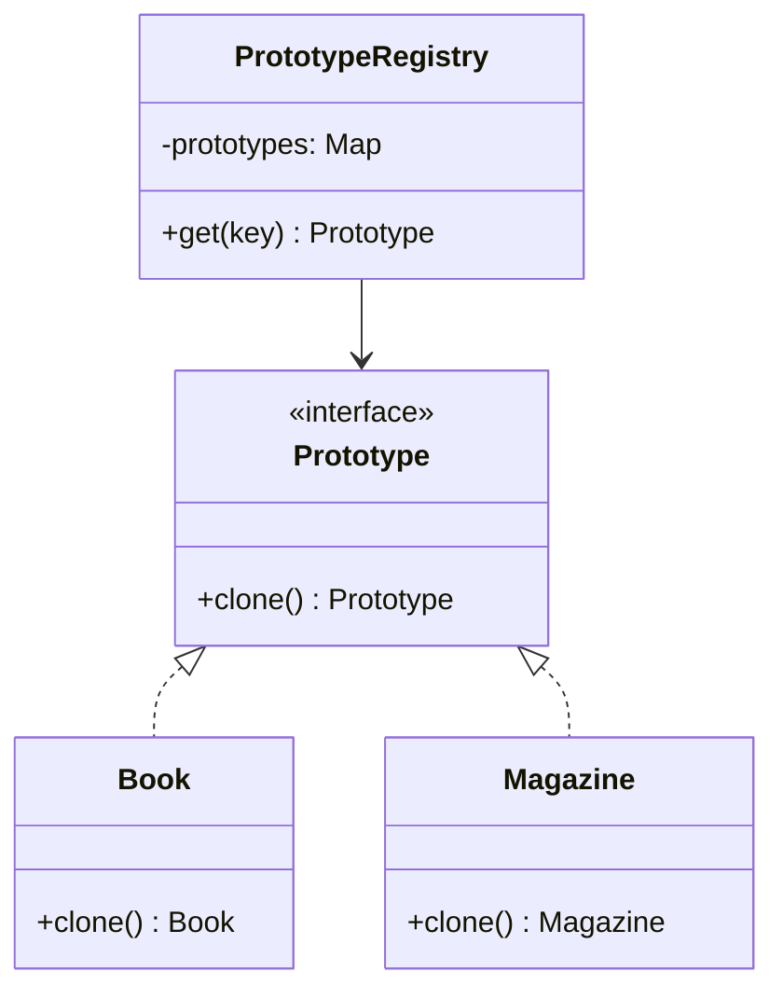

# Prototype

**Família:** criacional

## Problema

Uma biblioteca digital cria livros, revistas e teses a partir de configurações caras de montar (metadados, regras de catalogação, permissões). Instanciar cada um do zero é lento, e o cliente precisaria conhecer cada classe concreta e seus detalhes internos para copiar um objeto existente.

## Intenção

> Criar novos objetos **copiando um protótipo** existente. O próprio objeto sabe se clonar, via `clone()`, então o cliente não depende das classes concretas.

## Estrutura



## Clonagem rasa x profunda

| Tipo | O que copia | Risco |
|---|---|---|
| **Rasa** (shallow) | O objeto; **referências** internas continuam apontando para os mesmos objetos | Alterar um objeto interno afeta clone e original |
| **Profunda** (deep) | O objeto **e** tudo o que ele referencia | Mais custo; cuidado com referências circulares |

```ts
const original = { title: 'DDD', tags: ['arquitetura'] }

const shallow = { ...original }
shallow.tags.push('ddd')          // ⚠️ altera original.tags também

const deep = structuredClone(original)
deep.tags.push('patterns')        // original intacto
```

> 💡 **Clonar ≠ copiar a referência.** `const b = a` não cria nada: `a` e `b` são o mesmo objeto. Clonar gera um objeto **novo e independente**.

## Exemplo: registro de protótipos

```ts
interface Prototype<T> {
  clone(): T
}

class Book implements Prototype<Book> {
  constructor(
    public title = 'Unknown',
    public author = 'Unknown',
    public pages = 0,
    public tags: string[] = [],
  ) {}

  clone(): Book {
    return new Book(this.title, this.author, this.pages, [...this.tags]) // cópia profunda do array
  }
}

class Magazine implements Prototype<Magazine> {
  constructor(public title = 'Unknown', public edition = 0) {}
  clone() { return new Magazine(this.title, this.edition) }
}

class PrototypeRegistry {
  private readonly prototypes = new Map<string, Prototype<unknown>>()

  register(key: string, prototype: Prototype<unknown>) { this.prototypes.set(key, prototype) }

  create<T>(key: string): T {
    const prototype = this.prototypes.get(key)
    if (!prototype) throw new Error(`No prototype for ${key}`)
    return prototype.clone() as T
  }
}

const registry = new PrototypeRegistry()
registry.register('book', new Book())
registry.register('magazine', new Magazine())

const book1 = registry.create<Book>('book')
book1.title = 'Domain-Driven Design'
const book2 = registry.create<Book>('book')
book2.title = 'Clean Architecture'
// book1 e book2 são independentes; o protótipo continua com valores padrão
```

## Prototype com objetos imutáveis

Com Value Objects imutáveis, "clonar com uma mudança" é um padrão muito comum (`with`):

```ts
class QuoteRequest {
  constructor(readonly from: string, readonly to: string, readonly weightKg: number) {}

  with(changes: Partial<Pick<QuoteRequest, 'from' | 'to' | 'weightKg'>>) {
    return new QuoteRequest(changes.from ?? this.from, changes.to ?? this.to, changes.weightKg ?? this.weightKg)
  }
}

const base = new QuoteRequest('01310100', '20040002', 1)
const heavier = base.with({ weightKg: 5 })
```

## Quando usar / evitar

| Use | Evite |
|---|---|
| Criar do zero é caro e há poucas combinações de estado | Objetos simples de instanciar |
| As classes concretas são definidas em runtime | Objetos com recursos não clonáveis (conexões, sockets) |
| Evitar uma hierarquia de fábricas paralela à de produtos | |

## Consequências

- ✅ Esconde as classes concretas do cliente.
- ✅ Adiciona e remove "tipos" em runtime (registrando protótipos).
- ✅ Reduz subclasses só para variar configuração.
- ⚠️ Clonar objetos com **referências circulares** é complexo.
- ⚠️ Decidir entre raso e profundo exige cuidado.

## Relacionados

[Abstract Factory](abstract-factory.md) (pode guardar protótipos e cloná-los) · [Memento](../comportamentais/memento.md) (snapshots do estado).

## Para fixar

1. Qual o risco de uma cópia rasa?
2. Qual a diferença entre `const b = a` e `b = a.clone()`?

<details>
<summary>Respostas</summary>

1. Objetos internos referenciados ficam compartilhados: alterar no clone altera no original.
2. `const b = a` só copia a referência (mesmo objeto). `clone()` cria um objeto novo e independente.

</details>
