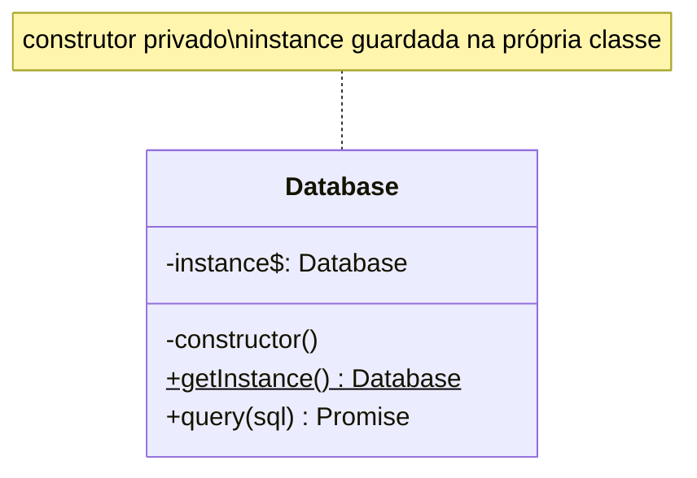

# Singleton

**Família:** criacional

## Problema

Cada parte do sistema que precisa do banco cria uma **nova conexão**. Com 50 requisições simultâneas, são 50 conexões abertas, e o banco recusa as próximas.

## Intenção

> Garantir que uma classe tenha **apenas uma instância** e fornecer um **ponto de acesso global** a ela.

## Estrutura



## Exemplo clássico

```ts
class Database {
  static #instance: Database | null = null

  private constructor(private readonly url: string) {
    // abre o pool de conexões uma única vez
  }

  static getInstance(): Database {
    if (!Database.#instance) Database.#instance = new Database(process.env.DATABASE_URL ?? '')
    return Database.#instance
  }

  async query(sql: string) { /* usa o pool */ }
}

const a = Database.getInstance()
const b = Database.getInstance()
a === b // true: a mesma instância
```

Características:
- **Construtor privado:** ninguém faz `new Database()`.
- **Instância estática** guardada na classe.
- **`getInstance()`** cria só na primeira chamada (*lazy*).

## A forma idiomática em TypeScript: o módulo

Módulos ES são avaliados **uma vez**. Exportar uma instância já é um singleton, sem cerimônia:

```ts
// infra/database.ts
export const db = createPool(process.env.DATABASE_URL)
```

E a variação com escolha por configuração (Factory + Singleton):

```ts
// building-blocks/factories/consumer-factory.ts
let instance: Consumer | null = null

export function getConsumer(env: Env): Consumer {
  if (instance) return instance
  instance = env.CONSUMER_PROVIDER === 'kafka' ? new KafkaConsumer(env) : new RabbitMQConsumer(env)
  return instance
}
```

## O lado sombrio

> ⚠️ O Singleton é o padrão **mais criticado** do GoF. Ele é, na prática, uma **variável global** com outro nome.

| Problema | Por quê |
|---|---|
| **Acoplamento escondido** | Quem chama `Database.getInstance()` depende do banco, mas isso não aparece no construtor |
| **Testes difíceis** | Não dá para trocar por um dublê facilmente; o estado vaza entre testes |
| **Viola SRP** | A classe cuida do negócio **e** de controlar quantas instâncias existem |
| **Estado global mutável** | Uma parte do código altera e afeta todas as outras |

```ts
// ❌ usecase com dependência escondida
class CreateOrderUseCase {
  async execute(input: Input) {
    await Database.getInstance().query('INSERT ...') // impossível testar sem banco
  }
}

// ✅ a instância única é criada no main e INJETADA
class CreateOrderUseCase {
  constructor(private readonly orders: OrderRepository) {}
}
// main.ts
const db = Database.getInstance()
const usecase = new CreateOrderUseCase(new OrderPostgresRepository(db))
```

> 💡 **Regra prática:** "uma única instância" é uma decisão de **composição** (feita no `main`), não da classe. Crie uma vez no composition root e **injete**. O resto do código nem sabe que é única.

## Quando usar / evitar

| Use | Evite |
|---|---|
| Recurso realmente único por processo: pool de conexões, cliente de broker, logger, configuração | Para "facilitar o acesso" a qualquer coisa |
| Na **borda** (main, factories de building-blocks) | Dentro do domínio ou de usecases |

## Consequências

- ✅ Controle de uma instância única (economia de recursos).
- ✅ Inicialização preguiçosa.
- ⚠️ Estado global, dependências escondidas, testes frágeis.
- ⚠️ Em ambientes com vários processos/workers, "único" é por processo, não por sistema.

## Relacionados

[Abstract Factory](abstract-factory.md), [Builder](builder.md) e [Facade](../estruturais/facade.md) costumam ter uma única instância · [Flyweight](../estruturais/flyweight.md) (compartilhamento de instâncias).

## Para fixar

1. Por que Singleton dificulta testes?
2. Qual a alternativa recomendada?

<details>
<summary>Respostas</summary>

1. Porque a dependência fica escondida (o código busca a instância global em vez de recebê-la) e o estado vaza entre testes.
2. Criar a instância única no composition root (`main`) e injetá-la nos construtores.

</details>
