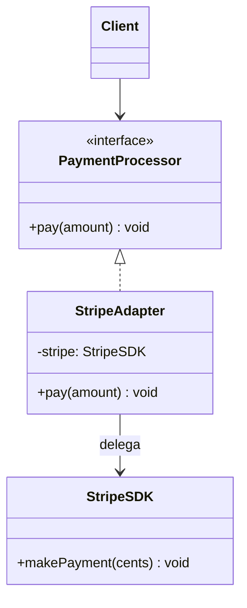

# Adapter

**Família:** estrutural

## Problema

Seu código espera `paymentProcessor.pay(49.99)`. O SDK do provedor oferece `stripe.makePayment(4999)` (em centavos, com outro nome). Espalhar chamadas ao SDK pelo código prende você a ele: trocar de provedor vira uma refatoração enorme.

## Intenção

> **Converter a interface** de uma classe em **outra interface que o cliente espera**, permitindo que classes incompatíveis trabalhem juntas.

## Estrutura



| Papel | No exemplo |
|---|---|
| **Target** (o que o cliente espera) | `PaymentProcessor` |
| **Adaptee** (o que existe, incompatível) | `StripeSDK` |
| **Adapter** (o tradutor) | `StripeAdapter` |

## Adapter de objeto (composição): o mais comum

```ts
// data/payment.ts — a interface que o SEU sistema define
export interface PaymentProcessor {
  pay(amount: Money): Promise<{ transactionId: string }>
}

// SDK de terceiros (você não controla)
class StripeSDK {
  async makePayment(cents: number): Promise<{ id: string }> { /* ... */ return { id: 'pi_123' } }
}

// infra/adapters/stripe-payment-processor.ts
export class StripePaymentProcessor implements PaymentProcessor {
  constructor(private readonly stripe: StripeSDK) {}  // TEM UM sdk (composição)

  async pay(amount: Money) {
    const result = await this.stripe.makePayment(amount.cents) // traduz unidade e nome
    return { transactionId: result.id }                         // traduz o formato de volta
  }
}
```

## Adapter de classe (herança)

O adapter **herda** do adaptee e implementa o target. Menos flexível: fica preso a uma classe concreta.

```ts
class StripeClassAdapter extends StripeSDK implements PaymentProcessor {
  async pay(amount: Money) {
    const result = await this.makePayment(amount.cents)
    return { transactionId: result.id }
  }
}
```

| Tipo | Técnica | Flexível? |
|---|---|---|
| **De objeto** | Composição | ✅ Funciona com qualquer instância (e subclasses) do adaptee |
| **De classe** | Herança | ❌ Preso a uma classe; expõe métodos do adaptee |

## Exemplo arquitetural: um contrato, várias tecnologias

```ts
// building-blocks/data/http.ts
export interface HttpClient {
  get<T>(url: string): Promise<T>
  post<T>(url: string, body: unknown): Promise<T>
}

// building-blocks/adapters/http/axios-http-client.ts
export class AxiosHttpClient implements HttpClient {
  constructor(private readonly axios: AxiosInstance) {}
  async get<T>(url: string) { return (await this.axios.get<T>(url)).data }
  async post<T>(url: string, body: unknown) { return (await this.axios.post<T>(url, body)).data }
}

// building-blocks/adapters/http/fetch-http-client.ts
export class FetchHttpClient implements HttpClient {
  async get<T>(url: string) { return (await fetch(url)).json() as Promise<T> }
  async post<T>(url: string, body: unknown) {
    const response = await fetch(url, {
      method: 'POST',
      headers: { 'content-type': 'application/json' },
      body: JSON.stringify(body),
    })
    return response.json() as Promise<T>
  }
}
```

O resto do sistema só conhece `HttpClient`. Trocar axios por fetch é mudar **uma linha** no `main`.

## Os dois sentidos na arquitetura

| Direção | De → para | Exemplos |
|---|---|---|
| **Inbound** (entrada) | Mundo externo → sistema | Controllers, resolvers GraphQL, consumers de fila |
| **Outbound** (saída) | Sistema → mundo externo | Repositórios, gateways de pagamento, clientes HTTP, publishers |

Esse é o "Adapter" da **Arquitetura Hexagonal** (Ports **and Adapters**). E um adapter que **traduz modelos** entre contextos é uma **Anticorruption Layer** ([2.5](../../modulo-02-ddd-estrategico/05-context-mapping.md)).

## Quando usar / evitar

| Use | Evite |
|---|---|
| Integrar SDK, biblioteca de terceiros ou sistema legado | A interface já é a que você precisa |
| Proteger o domínio de detalhes externos | Para "adaptar" código seu, que você poderia simplesmente mudar |
| Ter várias implementações para o mesmo contrato | |

## Consequências

- ✅ Desacopla o cliente da implementação concreta.
- ✅ Reutiliza código existente sem modificá-lo.
- ✅ Testável: o contrato é fácil de substituir por um dublê.
- ⚠️ Uma camada a mais; adapters muito "espertos" escondem regra.

## Relacionados

[Facade](facade.md) (simplifica um subsistema, em vez de converter uma interface) · [Bridge](bridge.md) (separa dimensões de propósito, desde o início) · [Decorator](decorator.md) (mesma interface, adiciona comportamento) · [Proxy](proxy.md) (mesma interface, controla acesso).

## Para fixar

1. Por que o adapter de objeto é mais comum que o de classe?
2. Um repository Postgres é um adapter?

<details>
<summary>Respostas</summary>

1. Porque usa composição: funciona com qualquer instância do adaptee e não fica preso a uma hierarquia.
2. Sim, um adapter de saída (outbound): implementa um contrato do sistema usando uma tecnologia concreta.

</details>
