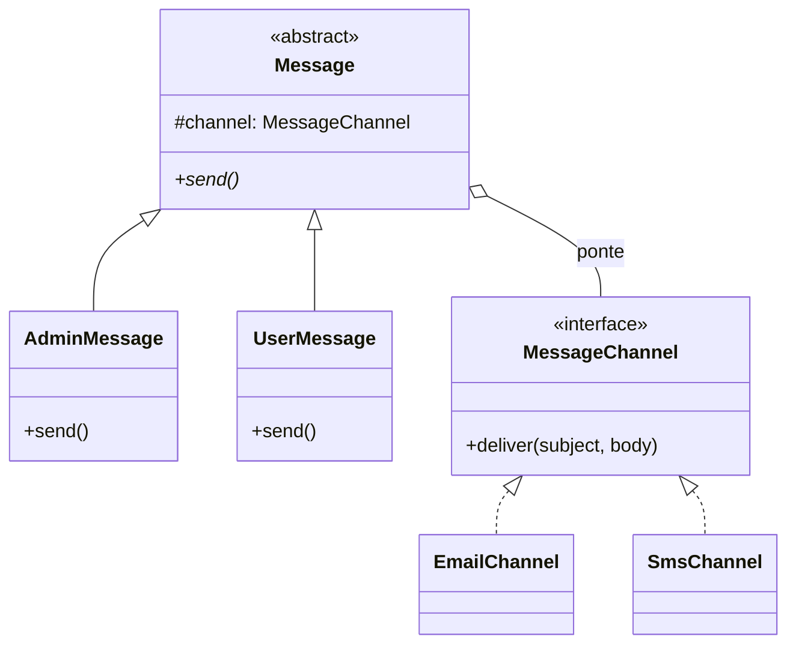

# Bridge

**Família:** estrutural

## Problema

Um sistema envia mensagens. Há **tipos de remetente** (administrador, usuário) e **canais** (e-mail, SMS). Com herança, cada combinação vira uma classe:

```text
AdminEmailMessage   AdminSmsMessage   AdminPushMessage
UserEmailMessage    UserSmsMessage    UserPushMessage
```

2 remetentes × 3 canais = 6 classes. Com 4 remetentes e 5 canais, 20. O crescimento é **multiplicativo**.

## Intenção

> **Desacoplar uma abstração da sua implementação**, para que as duas possam **variar independentemente**. Divide-se uma hierarquia em **duas**, ligadas por composição (a "ponte").

## Estrutura



| Papel | No exemplo |
|---|---|
| **Abstraction** | `Message` (mantém a referência ao implementador) |
| **Refined Abstraction** | `AdminMessage`, `UserMessage` |
| **Implementor** | `MessageChannel` (operações primitivas) |
| **Concrete Implementor** | `EmailChannel`, `SmsChannel` |

Agora são 2 + 3 = **5 classes**, e não 6. Com 4 × 5, são 9 em vez de 20.

## Exemplo

```ts
// implementação: COMO enviar
interface MessageChannel {
  deliver(subject: string, body: string): Promise<void>
}

class EmailChannel implements MessageChannel {
  async deliver(subject: string, body: string) { console.log(`[EMAIL] ${subject}: ${body}`) }
}

class SmsChannel implements MessageChannel {
  async deliver(subject: string, body: string) { console.log(`[SMS] ${subject} — ${body}`.slice(0, 160)) }
}

// abstração: O QUE enviar e com que regras
abstract class Message {
  constructor(
    protected readonly channel: MessageChannel, // a ponte
    protected readonly subject: string,
    protected readonly body: string,
  ) {}
  abstract send(): Promise<void>
}

class AdminMessage extends Message {
  async send() {
    await this.channel.deliver(`[ADMIN] ${this.subject}`, this.body)
  }
}

class UserMessage extends Message {
  async send() {
    await this.channel.deliver(this.subject, `${this.body}\n\nResponda pelo app.`)
  }
}

await new AdminMessage(new EmailChannel(), 'Manutenção', 'Hoje às 22h').send()
await new UserMessage(new SmsChannel(), 'Pedido', 'Saiu para entrega').send()
```

Adicionar `PushChannel` não toca nas mensagens. Adicionar `SystemMessage` não toca nos canais.

## Bridge na arquitetura

O padrão aparece toda vez que **a abstração de negócio** é separada **da tecnologia**:

| Abstração | Ponte | Implementação |
|---|---|---|
| `Repository` do domínio | interface | Postgres, Mongo, memória |
| `Notifier` | interface | E-mail, SMS, push |
| `Storage` | interface | S3, disco local, GCS |

## Quando usar / evitar

| Use | Evite |
|---|---|
| Há **duas dimensões** que variam independentemente | Só existe uma dimensão de variação |
| Você quer evitar explosão de subclasses | A combinação é fixa e pequena |
| Quer trocar a implementação em runtime | |

## Consequências

- ✅ Abstrações e implementações evoluem separadamente (OCP).
- ✅ Esconde detalhes de implementação do cliente.
- ✅ "Composição sobre herança" aplicada.
- ⚠️ Mais indireção; exige identificar as dimensões cedo.

## Bridge x Adapter

| | Bridge | Adapter |
|---|---|---|
| Quando | Desenhado **antes**, no design | Aplicado **depois**, para integrar algo existente |
| Objetivo | Separar duas dimensões | Compatibilizar interfaces |

## Relacionados

[Adapter](adapter.md) · [Strategy](../comportamentais/strategy.md) (estrutura parecida; Strategy foca em trocar algoritmos) · [Abstract Factory](../criacionais/abstract-factory.md) (pode criar a combinação certa de abstração e implementação).

## Para fixar

1. Quantas classes há com 3 tipos de mensagem e 4 canais, com e sem Bridge?
2. O que é a "ponte" no exemplo?

<details>
<summary>Respostas</summary>

1. Sem Bridge: 3 × 4 = 12. Com Bridge: 3 + 4 = 7 (mais as classes base).
2. A referência `channel` dentro de `Message`, que liga a hierarquia de mensagens à de canais.

</details>
