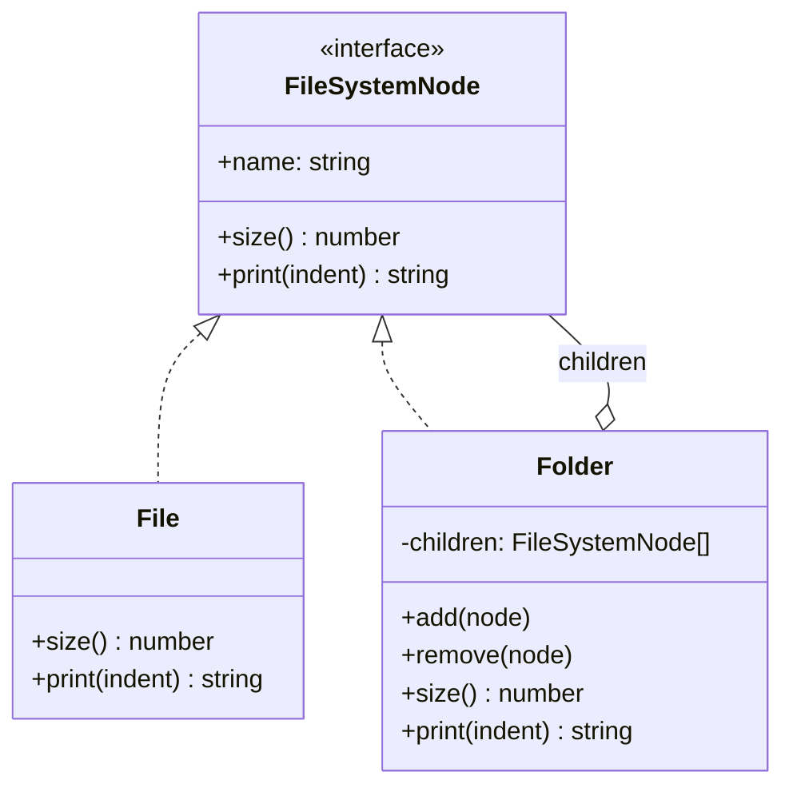

# Composite

**Família:** estrutural

## Problema

Um gerenciador de arquivos tem **pastas** que contêm **arquivos e outras pastas**. Para calcular o tamanho total ou exibir a árvore, o código fica cheio de `if (item instanceof Folder) ... else ...`, repetido em cada operação.

## Intenção

> Compor objetos em **estruturas de árvore** para representar hierarquias **parte-todo**, permitindo que o cliente trate **objetos individuais (folhas)** e **composições (nós)** de forma **uniforme**.

## Estrutura



| Papel | No exemplo |
|---|---|
| **Component** | `FileSystemNode` (interface comum) |
| **Leaf** (folha) | `File`: não tem filhos |
| **Composite** (nó) | `Folder`: guarda filhos e delega a eles |
| **Client** | Quem usa a árvore só pelo `Component` |

## Exemplo

```ts
interface FileSystemNode {
  readonly name: string
  size(): number
  print(indent?: string): string
}

class File implements FileSystemNode {
  constructor(readonly name: string, private readonly bytes: number) {}
  size() { return this.bytes }
  print(indent = '') { return `${indent}- ${this.name} (${this.bytes} B)` }
}

class Folder implements FileSystemNode {
  private readonly children: FileSystemNode[] = []

  constructor(readonly name: string) {}

  add(...nodes: FileSystemNode[]) { this.children.push(...nodes); return this }
  remove(node: FileSystemNode) {
    const index = this.children.indexOf(node)
    if (index >= 0) this.children.splice(index, 1)
  }

  size(): number {
    return this.children.reduce((total, child) => total + child.size(), 0) // recursão natural
  }

  print(indent = ''): string {
    return [`${indent}## ${this.name}/`, ...this.children.map((child) => child.print(indent + '  '))].join('\n')
  }
}

const root = new Folder('root').add(
  new Folder('docs').add(new File('ddd.md', 1200), new File('cqrs.md', 800)),
  new Folder('src').add(new Folder('domain').add(new File('order.ts', 3000))),
  new File('README.md', 500),
)

root.size()   // 5500
root.print()
```

```text
## root/
  ## docs/
    - ddd.md (1200 B)
    - cqrs.md (800 B)
  ## src/
    ## domain/
      - order.ts (3000 B)
  - README.md (500 B)
```

Nenhum `instanceof`: `size()` e `print()` funcionam igual para arquivo e pasta.

## Transparência x segurança

Onde declarar `add` e `remove`?

| Opção | Como | Prós | Contras |
|---|---|---|---|
| **Transparência** | `add/remove` na interface comum; a folha lança "operação não suportada" | Cliente trata tudo igual | A folha tem métodos que não fazem sentido (viola LSP) |
| **Segurança** | `add/remove` só no `Folder` (como acima) | Tipos honestos | O cliente às vezes precisa saber se é pasta |

📌 Em TypeScript, prefira **segurança**: o compilador ajuda e não há métodos que lançam erro.

## Composite no mundo real

- **Árvore de UI**: componentes que contêm componentes (React, DOM).
- **Regras compostas**: `AndRule(rule1, OrRule(rule2, rule3))`, que é a ponte para o [Interpreter](../comportamentais/interpreter.md).
- **Menus e categorias** aninhadas.
- **Pacotes e volumes**: um pacote contém volumes ou outros pacotes; o peso total é recursivo.
- **Organograma**: departamentos com pessoas e subdepartamentos.

## Quando usar / evitar

| Use | Evite |
|---|---|
| Há uma hierarquia **parte-todo** recursiva | A estrutura é plana |
| O cliente quer tratar item e grupo da mesma forma | Folhas e nós têm comportamentos muito diferentes |

## Consequências

- ✅ Hierarquias recursivas com código simples.
- ✅ Fácil adicionar novos tipos de nó.
- ⚠️ Pode ficar genérico demais: restringir "esta pasta só aceita PDFs" exige checagem em runtime.

## Relacionados

[Decorator](decorator.md) (embrulha **um**; Composite agrega **vários**) · [Iterator](../comportamentais/iterator.md) (percorrer a árvore) · [Visitor](../comportamentais/visitor.md) (novas operações sobre a árvore) · [Interpreter](../comportamentais/interpreter.md) (a árvore sintática é um Composite).

## Para fixar

1. O que diferencia a folha do nó no Composite?
2. Por que `size()` da pasta não precisa de `instanceof`?

<details>
<summary>Respostas</summary>

1. A folha não tem filhos e faz o trabalho diretamente. O nó guarda filhos e delega a eles.
2. Porque todos os filhos implementam a mesma interface: a pasta chama `child.size()`, e cada um responde do seu jeito.

</details>
