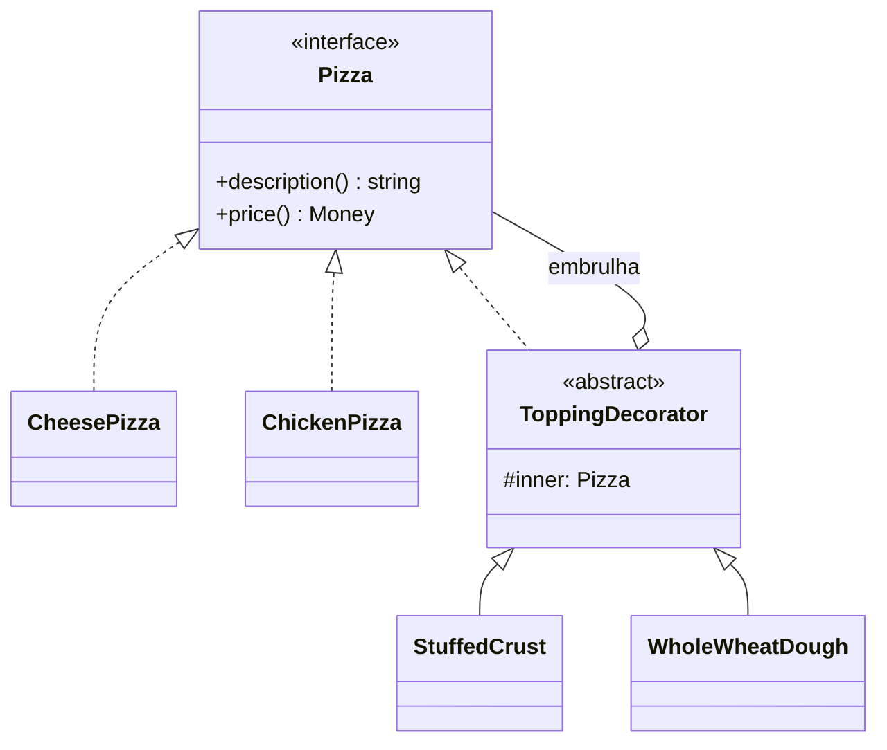
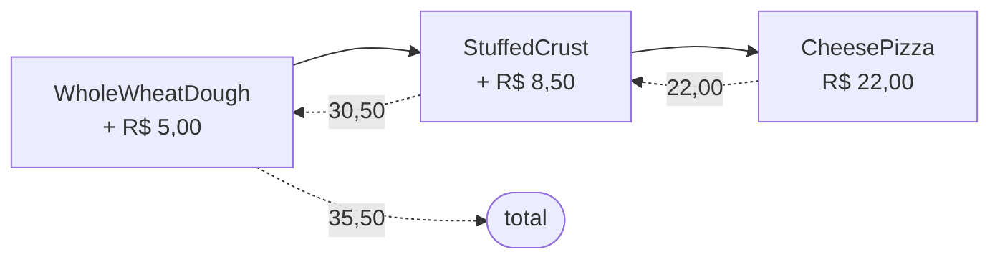

# Decorator

**Família:** estrutural

## Problema

Uma pizzaria tem pizzas (frango R$ 19, calabresa R$ 25, queijo R$ 22) e adicionais (borda recheada R$ 8,50, massa integral R$ 5). Com herança:

```text
PizzaQueijoBordaRecheada   PizzaQueijoMassaIntegral   PizzaQueijoBordaRecheadaMassaIntegral
PizzaFrangoBordaRecheada   PizzaFrangoMassaIntegral   ...
```

O número de classes explode, a combinação é fixa em tempo de compilação, e adicionais que não fazem sentido (borda recheada em pizza doce) ficam disponíveis para todas.

## Intenção

> **Adicionar responsabilidades a um objeto dinamicamente**, embrulhando-o num objeto com a **mesma interface**. Uma alternativa flexível à herança para estender comportamento.

## Estrutura



O decorator **é uma** `Pizza` e **tem uma** `Pizza`. Por isso é possível empilhar quantos quiser.



## Exemplo

```ts
interface Pizza {
  description(): string
  price(): Money
}

class CheesePizza implements Pizza {
  description() { return 'Pizza de queijo' }
  price() { return Money.fromCents(2200) }
}

class ChickenPizza implements Pizza {
  description() { return 'Pizza de frango' }
  price() { return Money.fromCents(1900) }
}

abstract class ToppingDecorator implements Pizza {
  constructor(protected readonly inner: Pizza) {}
  abstract description(): string
  abstract price(): Money
}

class StuffedCrust extends ToppingDecorator {
  description() { return `${this.inner.description()}, borda recheada` }
  price() { return this.inner.price().add(Money.fromCents(850)) }
}

class WholeWheatDough extends ToppingDecorator {
  description() { return `${this.inner.description()}, massa integral` }
  price() { return this.inner.price().add(Money.fromCents(500)) }
}

const pizza = new WholeWheatDough(new StuffedCrust(new CheesePizza()))
pizza.description() // 'Pizza de queijo, borda recheada, massa integral'
pizza.price().format() // 'R$ 35,50'
```

## O uso mais comum no backend: preocupações transversais

Decorators são perfeitos para adicionar **log, cache, métricas, retry** sem tocar na classe original.

```ts
interface QuoteGateway {
  quote(input: QuoteInput): Promise<Quote[]>
}

class CachedQuoteGateway implements QuoteGateway {
  constructor(private readonly inner: QuoteGateway, private readonly cache: Cache, private readonly ttlSeconds = 60) {}

  async quote(input: QuoteInput) {
    const key = `quote:${input.from}:${input.to}:${input.weightKg}`
    const hit = await this.cache.get<Quote[]>(key)
    if (hit) return hit
    const result = await this.inner.quote(input)
    await this.cache.set(key, result, this.ttlSeconds)
    return result
  }
}

class RetryingQuoteGateway implements QuoteGateway {
  constructor(private readonly inner: QuoteGateway, private readonly attempts = 3) {}

  async quote(input: QuoteInput) {
    let lastError: unknown
    for (let attempt = 1; attempt <= this.attempts; attempt++) {
      try { return await this.inner.quote(input) }
      catch (error) { lastError = error; await sleep(2 ** attempt * 100) }
    }
    throw lastError
  }
}

// main: monta a pilha
const gateway: QuoteGateway =
  new CachedQuoteGateway(new RetryingQuoteGateway(new AcmeCarrierQuoteAdapter(http)), redis)
```

O adapter da transportadora não sabe nada de cache nem de retry (SRP). A ordem da pilha é uma decisão do `main`.

> 💡 **Middlewares** de Express/Koa/Hono e os `@decorators` do TypeScript seguem a mesma ideia: embrulhar um comportamento com outro.

## Quando usar / evitar

| Use | Evite |
|---|---|
| Comportamentos opcionais e combináveis | Quando a ordem dos decorators gera bugs sutis e ninguém controla |
| Preocupações transversais (log, cache, retry, métricas) | Quando você precisa da **identidade** do objeto original (`===`) |
| Evitar explosão de subclasses | Uma única variação fixa (uma subclasse basta) |

## Consequências

- ✅ Mais flexível que herança: combina em runtime.
- ✅ Cada decorator tem uma responsabilidade (SRP).
- ⚠️ Muitas classes pequenas; depurar a pilha pode confundir.
- ⚠️ O objeto decorado **não é idêntico** ao original.

## Relacionados

[Proxy](proxy.md) (mesma estrutura; foca em controlar acesso) · [Composite](composite.md) (agrega vários; Decorator embrulha um) · [Chain of Responsibility](../comportamentais/chain-of-responsibility.md) (cada elo pode parar a cadeia; o decorator sempre delega) · [Strategy](../comportamentais/strategy.md) (troca o "miolo"; Decorator troca a "casca").

## Para fixar

1. Por que o decorator implementa a mesma interface do objeto que embrulha?
2. Onde fica a decisão da ordem dos decorators?

<details>
<summary>Respostas</summary>

1. Para poder ser usado no lugar do original e para poder ser embrulhado por outro decorator.
2. Na composição, normalmente no `main` ou numa factory.

</details>
