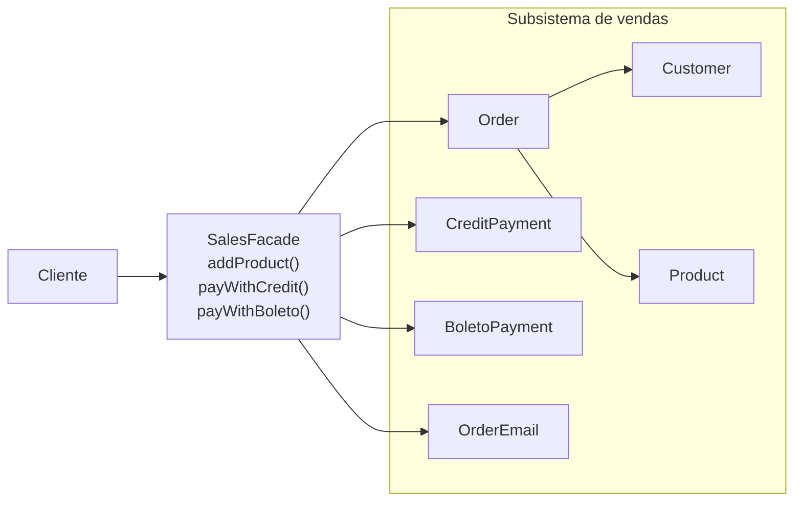

# Facade

**Família:** estrutural

## Problema

Para concluir uma venda, o cliente do código precisa conhecer e orquestrar `Customer`, `Product`, `Order`, `CreditPayment` ou `BoletoPayment`, `OrderEmail`... Cada tela ou endpoint repete essa sequência, e qualquer mudança interna no subsistema obriga a mexer em todos eles.

## Intenção

> Oferecer uma **interface unificada e simplificada** para um conjunto de interfaces de um subsistema, reduzindo o acoplamento entre o cliente e as classes internas.

## Estrutura



| Papel | Responsabilidade |
|---|---|
| **Facade** | Conhece o subsistema e delega as chamadas na ordem certa |
| **Subsistema** | Faz o trabalho; **não conhece** a facade |
| **Cliente** | Usa só a facade (mas pode acessar o subsistema se precisar) |

## Exemplo

```ts
class Customer {
  constructor(readonly name: string, readonly document: string, readonly email: string) {}
}

class Product {
  constructor(readonly name: string, readonly price: Money) {}
}

class Order {
  readonly #products: Product[] = []
  constructor(readonly customer: Customer) {}
  add(product: Product) { this.#products.push(product) }
  total() { return this.#products.reduce((sum, p) => sum.add(p.price), Money.zero()) }
}

interface Payment { process(order: Order): Promise<boolean> }
class CreditPayment implements Payment { async process() { return true } }
class BoletoPayment implements Payment { async process() { return true } }

class OrderEmail {
  async send(order: Order, message: string) {
    console.log(`E-mail para ${order.customer.email}: ${message}`)
  }
}

// A FACADE
class SalesFacade {
  private readonly order: Order
  private readonly email = new OrderEmail()

  constructor(customer: Customer) {
    this.order = new Order(customer)
  }

  addProduct(product: Product) {
    this.order.add(product)
    return this
  }

  payWithCredit() { return this.pay(new CreditPayment(), 'crédito') }
  payWithBoleto() { return this.pay(new BoletoPayment(), 'boleto') }

  private async pay(payment: Payment, method: string) {
    const approved = await payment.process(this.order)
    await this.email.send(
      this.order,
      approved ? `Pagamento aprovado via ${method}` : `Pagamento recusado via ${method}`,
    )
    return approved
  }
}

const customer = new Customer('Luiz da Silva', '12345678910', 'luiz@email.com')
await new SalesFacade(customer)
  .addProduct(new Product('Blusa', Money.fromCents(8099)))
  .addProduct(new Product('Camiseta', Money.fromCents(4998)))
  .payWithBoleto()
```

## Facade na arquitetura

| Onde | É uma facade porque... |
|---|---|
| **Usecase** | Esconde a orquestração de repositórios, domínio e eventos atrás de um `execute()` |
| **SDK de um serviço** | `shippingClient.contract(...)` esconde várias chamadas HTTP |
| **Módulo público** | Um `index.ts` que exporta só a API pública de um bounded context |
| **Building block** | `HttpAdapter.router()` esconde o framework web |

> 💡 Um **módulo bem desenhado tem uma facade**: o resto do sistema conversa com ela, e não com as entranhas do módulo. Isso reforça as fronteiras de contexto.

## Quando usar / evitar

| Use | Evite |
|---|---|
| Um subsistema complexo com um uso comum e simples | Para esconder um design ruim que deveria ser corrigido |
| Definir pontos de entrada entre camadas ou módulos | Quando vira um "God Object" que faz tudo |
| Reduzir dependências do cliente | |

## Consequências

- ✅ Menos objetos para o cliente conhecer.
- ✅ Acoplamento fraco: o subsistema muda sem afetar os clientes.
- ✅ Não impede o acesso direto ao subsistema, para quem precisar de mais controle.
- ⚠️ Pode crescer até virar um objeto que conhece tudo.

## Relacionados

[Adapter](adapter.md) (converte **uma** interface; Facade simplifica **várias**) · [Mediator](../comportamentais/mediator.md) (centraliza a comunicação **entre** colegas; a Facade só simplifica o acesso **de fora**) · [Abstract Factory](../criacionais/abstract-factory.md) (pode criar os objetos do subsistema para a facade).

## Para fixar

1. O subsistema conhece a facade?
2. Por que um usecase pode ser visto como uma facade?

<details>
<summary>Respostas</summary>

1. Não. A facade conhece o subsistema; o subsistema é independente dela.
2. Porque oferece um único método (`execute`) que esconde a orquestração de várias peças: repositórios, domínio, eventos.

</details>
