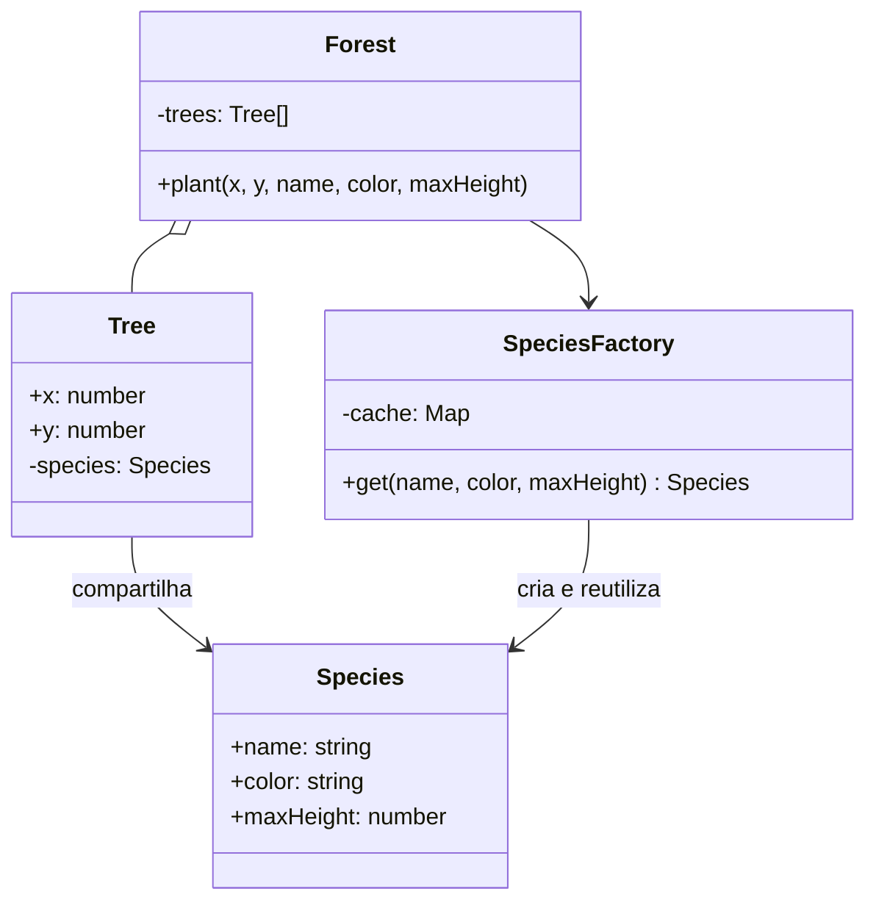

# Flyweight

**Família:** estrutural

## Problema

Um software de reflorestamento posiciona **milhões de árvores** num mapa. Cada árvore tem posição `x, y` e uma espécie (nome, cor, altura máxima, textura). Se cada árvore guardar os dados da espécie, a memória explode: são poucas espécies, mas os dados se repetem milhões de vezes.

## Intenção

> Usar **compartilhamento** para suportar grandes quantidades de objetos de **granularidade fina** de forma eficiente, separando o estado **intrínseco** (compartilhável) do **extrínseco** (específico de cada objeto).

## Os dois tipos de estado

| Estado | Característica | No exemplo |
|---|---|---|
| **Intrínseco** | Imutável, independe do contexto, **compartilhável** | Nome da espécie, cor, altura máxima |
| **Extrínseco** | Varia por objeto, depende do contexto | Posição `x`, `y` |

## Estrutura



## Exemplo

```ts
class Species {
  constructor(
    readonly name: string,
    readonly color: string,
    readonly maxHeight: number,
  ) {
    Object.freeze(this) // intrínseco = imutável
  }
}

class SpeciesFactory {
  private readonly cache = new Map<string, Species>()

  get(name: string, color: string, maxHeight: number): Species {
    const key = `${name}|${color}|${maxHeight}`
    let species = this.cache.get(key)
    if (!species) {
      species = new Species(name, color, maxHeight)
      this.cache.set(key, species)
    }
    return species
  }

  get count() { return this.cache.size }
}

class Tree {
  constructor(
    readonly x: number,
    readonly y: number,
    readonly species: Species, // referência compartilhada
  ) {}
}

class Forest {
  private readonly trees: Tree[] = []
  constructor(private readonly species = new SpeciesFactory()) {}

  plant(x: number, y: number, name: string, color: string, maxHeight: number) {
    this.trees.push(new Tree(x, y, this.species.get(name, color, maxHeight)))
  }

  stats() { return { trees: this.trees.length, species: this.species.count } }
}

const forest = new Forest()
for (let i = 0; i < 1_000_000; i++) {
  forest.plant(Math.random() * 500, Math.random() * 500, 'Ipê', '#2caf1e', 10)
  forest.plant(Math.random() * 500, Math.random() * 500, 'Palmeira', '#008a29', 7)
  forest.plant(Math.random() * 500, Math.random() * 500, 'Jabuticabeira', '#00b626', 5)
}
forest.stats() // { trees: 3000000, species: 3 }
```

### A conta

Suponha que os dados de uma espécie ocupem 17 kB:

| | Memória dos dados de espécie |
|---|---|
| Sem Flyweight | 3.000.000 × 17 kB ≈ **51 GB** |
| Com Flyweight | 3 × 17 kB ≈ **51 kB** |

## Flyweight no dia a dia

- **Strings internadas** e enums.
- **Value Objects imutáveis** reutilizados (`Money.zero()`, `Currency.BRL`).
- **Cache de objetos de configuração** (tabela de preços por região).
- Em jogos e editores gráficos: glifos de fonte, sprites, texturas.

## Quando usar / evitar

| Use | Evite |
|---|---|
| **Muitos** objetos, com custo de memória alto | Poucos objetos (a complexidade não paga) |
| Dá para separar estado intrínseco do extrínseco | Quando o estado compartilhado precisa mudar |
| A identidade dos objetos compartilhados não importa | |

## Consequências

- ✅ Economia drástica de memória.
- ⚠️ Custo de CPU para calcular ou passar o estado extrínseco.
- ⚠️ O estado compartilhado **precisa** ser imutável, senão uma mudança afeta todos.
- ⚠️ Remover flyweights exige garantir que ninguém mais os referencia.

## Relacionados

[Factory Method](../criacionais/factory-method.md) (a fábrica que reutiliza é o coração do padrão) · [Composite](composite.md) (folhas podem ser flyweights) · [Singleton](../criacionais/singleton.md) (um flyweight é uma "instância única por valor").

## Para fixar

1. O que é estado intrínseco?
2. Por que o estado intrínseco precisa ser imutável?

<details>
<summary>Respostas</summary>

1. A parte do estado que não depende do contexto e pode ser compartilhada entre muitos objetos.
2. Porque ele é compartilhado: uma mudança afetaria todos os objetos que o referenciam.

</details>
