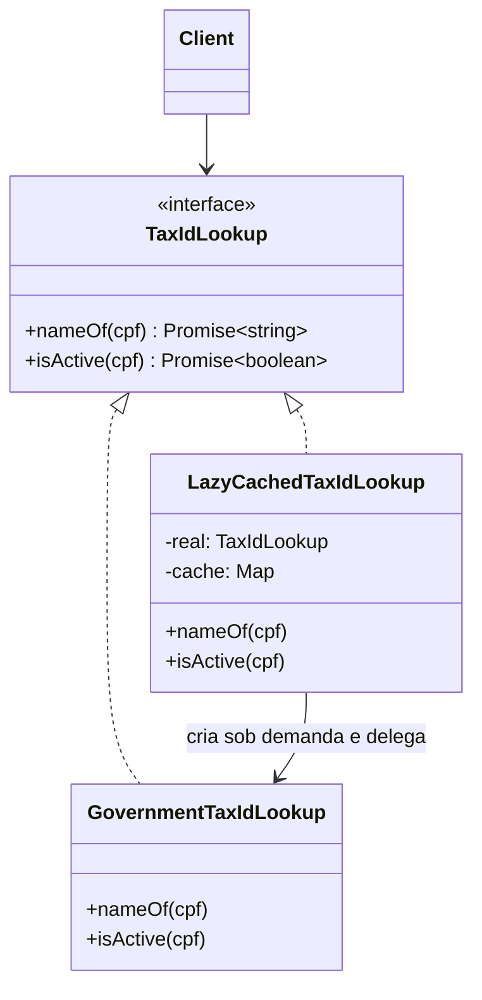

# Proxy

**Família:** estrutural

## Problema

A classe `TaxIdRegistry` consulta uma API do governo que leva **5 segundos** para conectar e **2 a 3 segundos** por consulta. Um `User` a cria no construtor "para o caso de precisar". Resultado: todo `new User(...)` demora 5 segundos, mesmo quando só queremos o nome.

## Intenção

> Fornecer um **substituto** (proxy) que **controla o acesso** a outro objeto, com a **mesma interface**. O cliente não sabe se está falando com o real ou com o proxy.

## Tipos de proxy

| Tipo | Controla | Exemplo |
|---|---|---|
| **Virtual** | **Quando** o objeto real é criado (*lazy*) | Só conecta na API ao primeiro uso |
| **Remoto** | **Onde** o objeto está | Um stub local de um serviço gRPC |
| **De proteção** | **Quem** pode acessar | Checa permissão antes de delegar |
| **Cache** (referência inteligente) | **Se** precisa chamar de novo | Guarda respostas recentes |
| **Logging / métricas** | Registra chamadas | Auditoria |

## Estrutura



## Exemplo: proxy virtual + cache

```ts
interface TaxIdLookup {
  nameOf(cpf: string): Promise<string>
  isActive(cpf: string): Promise<boolean>
}

class GovernmentTaxIdLookup implements TaxIdLookup {
  static async connect(): Promise<GovernmentTaxIdLookup> {
    await sleep(5000) // conexão cara
    return new GovernmentTaxIdLookup()
  }
  async nameOf(cpf: string) { await sleep(2000); return 'João da Silva' }
  async isActive(cpf: string) { await sleep(3000); return true }
}

class LazyCachedTaxIdLookup implements TaxIdLookup {
  #real: Promise<TaxIdLookup> | null = null
  readonly #cache = new Map<string, unknown>()

  private real() {
    this.#real ??= GovernmentTaxIdLookup.connect() // virtual: só conecta no primeiro uso
    return this.#real
  }

  private async cached<T>(key: string, load: () => Promise<T>): Promise<T> {
    if (this.#cache.has(key)) return this.#cache.get(key) as T // cache
    const value = await load()
    this.#cache.set(key, value)
    return value
  }

  nameOf(cpf: string) {
    return this.cached(`name:${cpf}`, async () => (await this.real()).nameOf(cpf))
  }

  isActive(cpf: string) {
    return this.cached(`active:${cpf}`, async () => (await this.real()).isActive(cpf))
  }
}

class User {
  constructor(
    readonly name: string,
    readonly cpf: string,
    private readonly lookup: TaxIdLookup, // pode ser o real ou o proxy
  ) {}

  async hasValidName() { return this.name === (await this.lookup.nameOf(this.cpf)) }
}

const user = new User('João da Silva', '11122233344', new LazyCachedTaxIdLookup())
user.name               // instantâneo: nada foi conectado
await user.hasValidName() // agora conecta (uma vez) e consulta
await user.hasValidName() // vem do cache
```

## Exemplo: proxy de proteção

```ts
class AuthorizedDocumentStorage implements DocumentStorage {
  constructor(private readonly inner: DocumentStorage, private readonly ctx: AuthContext) {}

  async read(id: string) {
    if (!this.ctx.can('read', 'Document')) throw new ForbiddenError('Cannot read documents')
    return this.inner.read(id)
  }

  async delete(id: string) {
    if (!this.ctx.can('delete', 'Document')) throw new ForbiddenError('Cannot delete documents')
    return this.inner.delete(id)
  }
}
```

## Proxy nativo do JavaScript

O JS tem o objeto `Proxy`, que intercepta operações em qualquer objeto:

```ts
function withLogging<T extends object>(target: T): T {
  return new Proxy(target, {
    get(obj, prop, receiver) {
      const value = Reflect.get(obj, prop, receiver)
      if (typeof value !== 'function') return value
      return (...args: unknown[]) => {
        console.log(`call ${String(prop)}`, args)
        return value.apply(obj, args)
      }
    },
  })
}
```

ORMs usam isso para **lazy loading** de relações.

## Proxy x Decorator

| | Proxy | Decorator |
|---|---|---|
| Estrutura | Mesma interface, embrulha o real | Mesma interface, embrulha o real |
| Intenção | **Controlar o acesso** | **Adicionar comportamento** |
| Quem cria o real | Muitas vezes o **próprio proxy** (lazy) | Quem monta recebe o objeto pronto |
| Empilhamento | Raro | Comum |

## Quando usar / evitar

| Use | Evite |
|---|---|
| Objeto caro de criar ou de chamar | Quando a indireção só adiciona latência |
| Controlar permissões de forma centralizada | Para esconder lentidão que deveria ser resolvida na origem |
| Cache, log, métricas transparentes | |

## Consequências

- ✅ Respeita OCP: novo controle sem mudar o objeto real.
- ✅ Esconde localização (remoto) e otimiza criação (virtual).
- ⚠️ Mais complexidade e, às vezes, mais latência.
- ⚠️ Cache no proxy precisa de política de expiração.

## Relacionados

[Decorator](decorator.md) · [Adapter](adapter.md) (muda a interface; Proxy mantém) · [Facade](facade.md).

## Para fixar

1. O que um proxy virtual faz?
2. Qual a diferença de intenção entre Proxy e Decorator?

<details>
<summary>Respostas</summary>

1. Adia a criação do objeto real (caro) até o primeiro momento em que ele é necessário.
2. O Proxy controla o acesso (quando, quem, se precisa). O Decorator adiciona comportamento.

</details>
