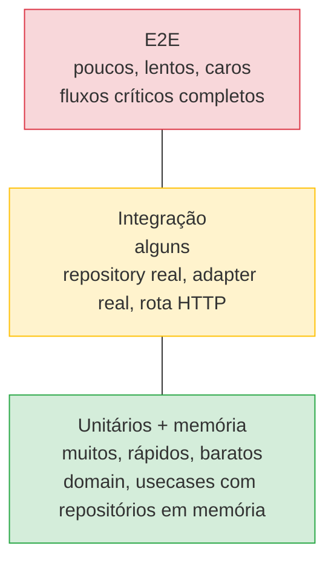
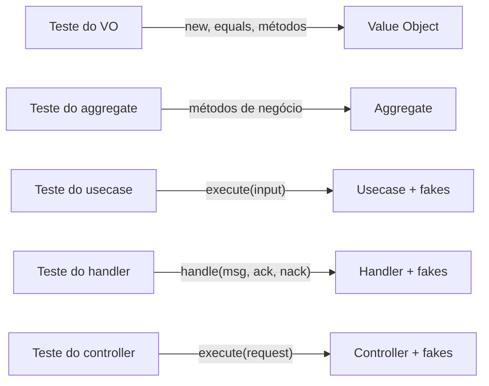

# 7.1 · Estratégia de testes

## Por que a arquitetura facilita testar

Tudo o que vimos tem um efeito colateral bom: **o núcleo não depende de I/O**. Isso permite testar a maior parte das regras com objetos em memória, em milissegundos.

> 💡 Se é difícil testar, é um sinal de design: provavelmente há acoplamento a infra no lugar errado.

## A pirâmide



| Nível | Testa | Dependências | Quantidade |
|---|---|---|---|
| **Unitário (domínio)** | VOs, Entities, Aggregates, Domain Services | Nenhuma | Muitos |
| **Usecase com memória** | Fluxo de aplicação | Repositórios e publishers **em memória** | Muitos |
| **Integração** | Repository, Query, Mutation, Adapter | Banco/serviço real (container) | Alguns |
| **Contrato** | Formato de eventos/APIs entre contextos | Schemas | Alguns |
| **E2E** | Fluxo do usuário de ponta a ponta | Tudo | Poucos |

## Testes "de memória"

> 📌 A maior parte da cobertura vem de testar **usecases com implementações em memória** dos contratos. Alta cobertura, baixo esforço, sem mocks frágeis.

```ts
describe('CancelShipmentUseCase', () => {
  const now = new Date('2026-05-10T12:00:00Z')

  test('cancels a contracted shipment and records the event', async () => {
    const shipments = new ShipmentMemoryRepository()
    await shipments.save(new ShipmentBuilder().contracted().withId('s-1').build())
    const usecase = new CancelShipmentUseCase(shipments)

    await usecase.execute({ shipmentId: 's-1', reason: 'customer request' }, now)

    const saved = await shipments.findById('s-1')
    expect(saved?.status).toBe('CANCELLED')
    expect(shipments.publishedEvents.map((e) => e.name)).toEqual(['shipment.cancelled'])
  })

  test('fails when the shipment does not exist', async () => {
    const usecase = new CancelShipmentUseCase(new ShipmentMemoryRepository())
    await expect(usecase.execute({ shipmentId: 'nope', reason: 'x' }, now)).rejects.toThrow(NotFoundError)
  })
})
```

## Dublês de teste (test doubles)

| Tipo | O que é | Quando usar |
|---|---|---|
| **Dummy** | Objeto só para preencher parâmetro | O parâmetro não é usado no caso |
| **Stub** | Devolve respostas prontas | Controlar uma entrada indireta ("a API devolve 3 cotações") |
| **Fake** | Implementação **funcional e simples** | **Repositório em memória**. O preferido deste curso |
| **Spy** | Registra como foi chamado | Verificar uma saída indireta ("publicou o evento?") |
| **Mock** | Expectativas pré-programadas que falham se não forem cumpridas | Com moderação: acopla o teste à implementação |

> ⚠️ **Prefira fakes a mocks.** Um teste cheio de `expect(repo.save).toHaveBeenCalledWith(...)` quebra a cada refatoração, mesmo quando o comportamento está correto. Um fake permite verificar o **resultado** ("o pedido está salvo como cancelado").

## Teste pelo contrato público

> 💡 Teste cada peça **pela porta que o nível de cima usa**. O domínio é testado por `new`, pelos métodos de negócio e pelos getters. O usecase, pelo `execute`. O handler, pelo `handle(message, ack, nack)`. **Não teste campos privados nem detalhes internos.**



Por quê:
- O teste descreve **comportamento**, que é o que importa para quem usa a peça.
- Refatorações internas não quebram os testes.
- Cada invariante é testada **no nível onde ela mora**: se "sem sobreposição" é do aggregate, o teste está no aggregate.

## Determinismo

Testes que falham "às vezes" destroem a confiança. Elimine as fontes de não determinismo **injetando-as**:

| Fonte | Como controlar |
|---|---|
| Data/hora | Receba `now: Date` como parâmetro |
| IDs | Receba `newId: string`, ou injete um gerador |
| Aleatoriedade | Injete um `random()` |
| Rede | Fakes/stubs de gateway |
| Ordem de execução | Nada de estado compartilhado entre testes; crie fakes novos em cada teste |

## Estrutura de um bom teste: Arrange, Act, Assert

```ts
test('debits the wallet when there is enough balance', () => {
  // Arrange
  const wallet = new Wallet('w-1', Money.fromCents(10_000))
  // Act
  wallet.debit(Money.fromCents(3_000), now)
  // Assert
  expect(wallet.balance.cents).toBe(7_000)
})
```

Regras práticas:
- **Um comportamento por teste.** O nome diz qual: `rejects debit greater than balance`.
- **O nome é uma frase do negócio**, não `test1`.
- **Sem lógica no teste** (`if`, laços). Se precisar, é outro teste.

## TDD em uma frase

Escreva o teste que falha (**red**), o mínimo que passa (**green**), e melhore o design com os testes protegendo (**refactor**). Com domínio puro, TDD é natural, porque não há infra no caminho.

## Para fixar

1. Por que preferir fake a mock?
2. Onde fica o teste da regra "um pedido pago não pode ser cancelado"?
3. Como tornar um teste com data determinístico?

<details>
<summary>Respostas</summary>

1. O fake permite verificar o resultado (estado final), em vez de como o código chegou lá. O teste sobrevive a refatorações.
2. No teste do aggregate `Order`, chamando `cancel()` depois de `markAsPaid()`.
3. Recebendo `now` como parâmetro em vez de chamar `new Date()` dentro do código.

</details>
