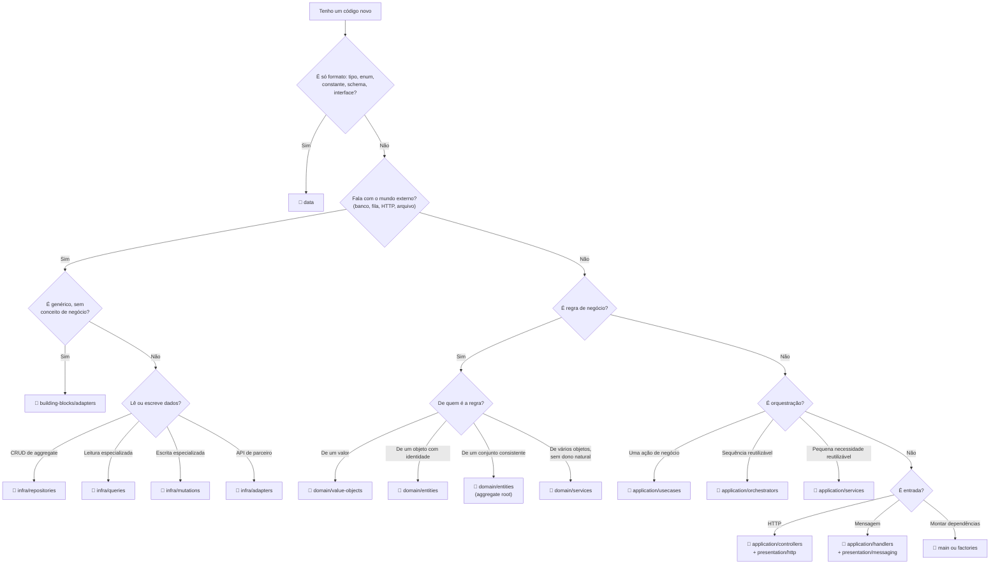

# 8.1 · Onde coloco isto? (guia de decisão)

Use esta página como consulta rápida durante o trabalho.

## A árvore de decisão

## Perguntas rápidas

| Pergunta | Se sim |
|---|---|
| "Preciso de `await` aqui?" | **Não** é domain |
| "Isto sabe o que é um frete/pedido?" | **Não** é building-block |
| "Isto chama outro usecase?" | Extraia para Orchestrator/Service |
| "Isto tem `if` sobre o status de uma entity?" | Mova para um método da entity |
| "Isto devolve a entity para fora (HTTP)?" | Converta para DTO |
| "Isto importa de `application` dentro de `infra`?" | Erro de dependência |
| "Isto cria `new PostgresX()` dentro de um usecase?" | Injete pelo construtor |
| "Esta função vai em `utils`?" | Ache o dono (provavelmente um VO) |

## Exemplos resolvidos

| Código | Onde | Por quê |
|---|---|---|
| `export const MAX_VOLUMES = 20` | `data/constants.ts` | Constante |
| `const quoteSchema = z.object({...})` | `data/quote.ts` | Schema |
| `interface CarrierGateway { quote(...) }` | `data/gateways.ts` | Contrato |
| `class Cep` com validação e `formatado` | `domain/value-objects` | Valor com regra |
| `class Volume` com `pesoCubado()` | `domain/entities` | Identidade + comportamento |
| `class Envio` que garante "até 20 volumes" | `domain/entities` | Aggregate root |
| `class CalculadoraDeFrete` | `domain/services` | Regra entre vários objetos, sem I/O |
| `class EnvioCancelado` | `domain/events` | Fato |
| SQL de `envios` + `volumes` | `infra/repositories/postgres` | Persistência do aggregate |
| Lista de envios com dados do cliente para uma tela | `infra/queries` | Leitura especializada |
| Cliente HTTP da API dos Correios | `infra/adapters` | Integração de negócio (ACL) |
| `FetchHttpClient` | `building-blocks/adapters` | Técnico, genérico |
| `CancelarEnvioUseCase` | `application/usecases` | Uma ação de negócio |
| Rota `POST /envios/:id/cancelar` | `presentation/http` | Entrada |
| `registerShutdown()` | `main/hooks` | Ciclo de vida |
