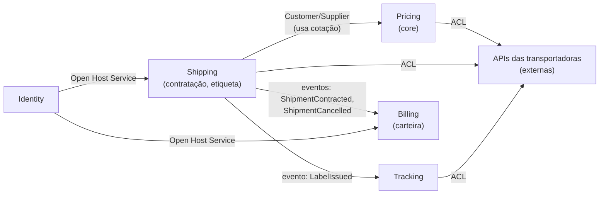
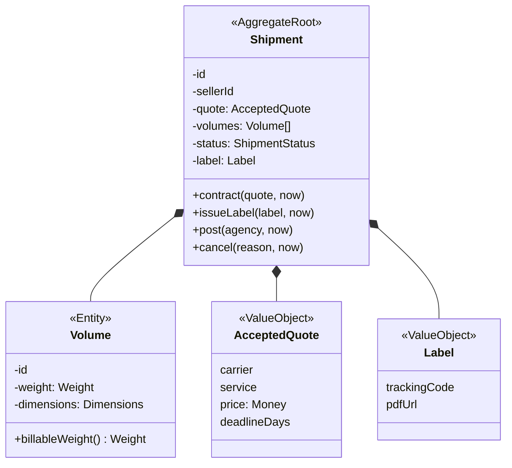
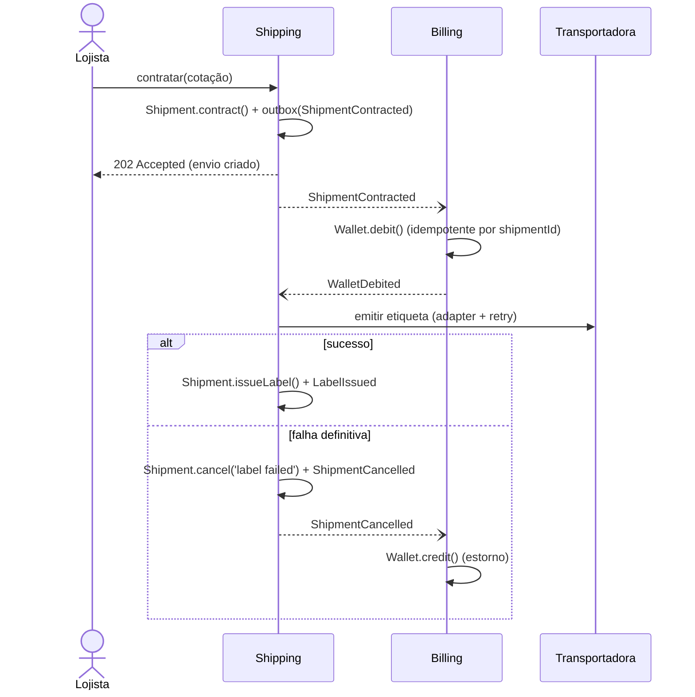

# 8.4 · Estudo de caso: plataforma de fretes para e-commerce

Um exercício de **pensar como arquiteto**, do problema ao código. Não há solução única; o objetivo é mostrar o **raciocínio**.

## 1. O negócio

> Lojistas online precisam **cotar** fretes em várias transportadoras, **contratar** o melhor, **imprimir etiqueta**, **acompanhar** a entrega e **pagar** com saldo pré-carregado numa carteira.

## 2. Linguagem ubíqua (trecho)

| Termo | Significado |
|---|---|
| **Cotação** | Preço e prazo de uma transportadora para um conjunto de volumes entre dois CEPs |
| **Volume** | Uma caixa com peso e dimensões |
| **Peso tarifável** | O maior entre o peso real e o cubado |
| **Contratar** | Escolher uma cotação e gerar um envio |
| **Envio** | O transporte contratado, com etiqueta e rastreio |
| **Postar** | Entregar o volume na agência |
| **Carteira** | Saldo pré-pago do lojista |
| **Estorno** | Devolução de valor à carteira |

## 3. Subdomínios

| Subdomínio | Tipo | Por quê |
|---|---|---|
| **Cotação e precificação** | **Core** | Achar o melhor preço/prazo é o diferencial |
| Contratação e etiqueta | Supporting | Necessário, específico, mas não diferencia |
| Rastreio | Supporting | Agrega valor, integra com transportadoras |
| Carteira e cobrança | Supporting | Regras financeiras próprias |
| Identidade, notificações | Generic | Usar pronto |

## 4. Context map



## 5. Decisões de arquitetura

| Decisão | Escolha | Trade-off aceito |
|---|---|---|
| Implantação | **Monolito modular** com um módulo por contexto | Escala conjunta, mas simplicidade operacional |
| Banco | Um Postgres, **um schema por módulo**, sem joins entre schemas | Disciplina; extrair um serviço depois fica fácil |
| Comunicação entre módulos | **Eventos** via outbox + broker | Consistência eventual em estornos |
| Cotação | Consulta em paralelo, **timeout de 3 s** por transportadora, ignora as que falharem | Às vezes uma opção boa fica de fora |
| Carteira | **Event Sourcing** no aggregate `Wallet` | Complexidade alta, justificada por auditoria financeira |
| Leitura de listagens | CQRS **nível 1** (Queries) | Nenhum custo relevante |

Cada uma dessas linhas vira um **ADR**.

## 6. Aggregates do módulo Shipping



Invariantes do `Shipment`:
- De 1 a 20 volumes.
- Só emite etiqueta depois de contratado.
- Só cancela se ainda não foi postado.
- Ciclo de vida: `CONTRACTED → LABELED → POSTED → DELIVERED`, com `CANCELLED` a partir de `CONTRACTED` ou `LABELED` (padrão **State**).

## 7. Fluxo crítico: contratar



Os padrões em jogo: **Saga** orquestrada, **Outbox**, **Adapter/ACL**, **Decorator** (retry), **State**, **Strategy** (seleção de cotação no Pricing), **Factory** (escolher o adapter de cada transportadora).

## 8. Estrutura do módulo Shipping

```text
src/modules/shipping/
├── data/            shipment.ts, constants.ts, repositories.ts, gateways.ts
├── domain/
│   ├── value-objects/  weight.ts, dimensions.ts, accepted-quote.ts, label.ts
│   ├── entities/       shipment.ts, volume.ts
│   ├── events/         shipment-contracted.ts, label-issued.ts, shipment-cancelled.ts
│   └── factories/      carrier-gateway-factory.ts
├── infra/
│   ├── repositories/   postgres/, memory/
│   ├── queries/        list-shipments-for-seller.ts
│   └── adapters/       acme-carrier.ts, fastship-carrier.ts
├── application/
│   ├── usecases/       contract-shipment.ts, issue-label.ts, cancel-shipment.ts
│   ├── orchestrators/  contract-shipment-saga.ts
│   ├── controllers/    contract-shipment.ts, cancel-shipment.ts
│   └── handlers/       wallet-debited.ts
└── presentation/
    ├── http/           shipping-router.ts
    └── messaging/      consumers.ts
```

## 9. Estratégia de testes

| O quê | Como |
|---|---|
| Invariantes do `Shipment` e `Volume` | Unitários, sem dependências |
| `ContractShipmentUseCase` | Repositório e publisher em memória |
| Saga | Simula a sequência de eventos (sucesso, falha da etiqueta, falha do débito) |
| Adapters das transportadoras | Integração contra um servidor fake (respostas gravadas) |
| Repository Postgres | Teste de contrato compartilhado com o fake |
| Fluxo contratar → etiqueta | Um E2E no ambiente de staging |

## 10. Perguntas para você responder

1. Por que o débito da carteira é feito por evento e não chamando Billing diretamente?
2. O que acontece se `ShipmentContracted` chegar duas vezes no Billing?
3. Se a transportadora demorar 30 s para emitir a etiqueta, o que muda no design?
4. Em que momento valeria extrair Pricing para um microserviço?

<details>
<summary>Respostas sugeridas</summary>

1. Para não acoplar Shipping a Billing nem depender da disponibilidade dele; e porque são aggregates diferentes (uma transação por aggregate).
2. Nada de errado: o débito é idempotente pelo `shipmentId`.
3. A emissão vira totalmente assíncrona: o lojista recebe "etiqueta em processamento" e é notificado depois (evento + notificação).
4. Quando a carga de cotação precisar escalar independente do resto, ou quando um time dedicado passar a ser dono do contexto, ou quando o ritmo de deploy dele divergir muito.

</details>
