# 00 — Como estudar este projeto

Este projeto junta dois repositórios do Jefferson William como **fonte da verdade** e adiciona guias, diagramas e um exemplo executável por cima. Nada em `sources/` foi alterado.

## Trilha sugerida

```mermaid
flowchart LR
    A["01 Visão geral<br/>(camadas e porquê)"] --> B["02 Estrutura de pastas"]
    B --> C["03 Data e Domain<br/>(o núcleo)"]
    C --> D["04 Infra"]
    D --> E["05 Application"]
    E --> F["06 Presentation, Main<br/>e Building blocks"]
    F --> G["07 Fluxo de uma requisição<br/>(juntando tudo)"]
    G --> H["08 Dependências e nomes"]
    H --> I["09 Testes"]
    I --> J["10 Design Patterns"]
    J --> K["11 CQRS e Event Sourcing"]
```

| Etapa | Arquivo | Tempo estimado | Você sai sabendo |
|---|---|---|---|
| 1 | [01-visao-geral](01-visao-geral.md) | 15 min | Por que existem camadas e qual a ordem de dentro para fora |
| 2 | [02-estrutura-de-pastas](02-estrutura-de-pastas.md) | 15 min | Onde cada tipo de arquivo mora |
| 3 | [03-data-e-domain](03-data-e-domain.md) | 45 min | O que é Data, Value Object, Entity, Aggregate, Domain Service, Factory, Mapper, Helper |
| 4 | [04-infra](04-infra.md) | 20 min | Repository, Query, Mutation, Adapter |
| 5 | [05-application](05-application.md) | 30 min | Usecase, Service, Orchestrator, Controller, Handler |
| 6 | [06-presentation-main-building-blocks](06-presentation-main-building-blocks.md) | 20 min | Como a requisição entra no sistema |
| 7 | [07-fluxo-de-requisicao](07-fluxo-de-requisicao.md) | 15 min | O caminho completo, HTTP e mensageria |
| 8 | [08-dependencias-e-nomenclatura](08-dependencias-e-nomenclatura.md) | 10 min | Quem pode importar quem e como nomear |
| 9 | [09-testes](09-testes.md) | 15 min | O que testar em cada nível |
| 10 | [10-design-patterns](10-design-patterns.md) | 60 min | Os 23 padrões do GoF e onde aparecem na arquitetura |
| 11 | [11-cqrs-e-event-sourcing](11-cqrs-e-event-sourcing.md) | 20 min | Separação leitura/escrita e eventos |

Depois de cada etapa, abra o arquivo correspondente em `sources/` e compare. Termine rodando o exemplo em [`examples/carrier-coverage-ddd`](../examples/carrier-coverage-ddd).

## Convenção de confiança

Cada guia deixa claro de onde vem a informação:

| Marca | Significa |
|---|---|
| **Fonte** | Está escrito nos repositórios do Jefferson. O arquivo é citado. |
| **Derivado** | Conclusão tirada das fontes, mas que elas não dizem explicitamente. |
| **Sugestão** | Escolha deste projeto de estudo, não vem das fontes. |

Quando um guia contradiz uma fonte, vale a fonte. Os pontos em que as próprias fontes se contradizem ou têm erros estão em [13-erratas-das-fontes](13-erratas-das-fontes.md).

## O que ainda não foi confirmado

A explicação do Jefferson sobre "o que testar, sempre o nível acima, o handle" **não está nos repositórios**. Ela veio por conversa. O guia [09-testes](09-testes.md) tem um espaço marcado para preencher quando você confirmar com ele.
