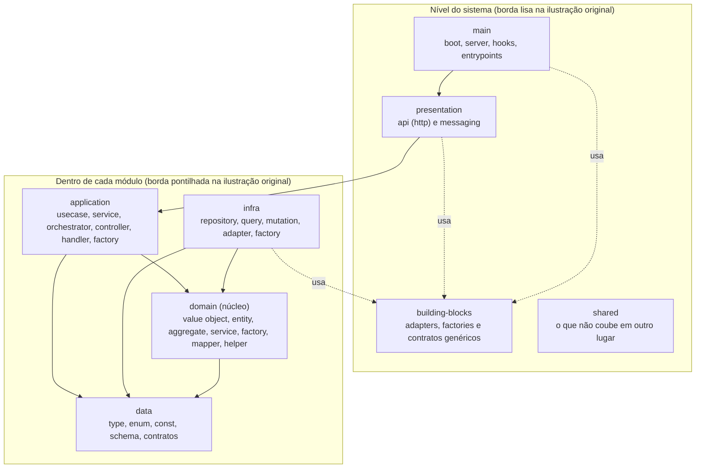
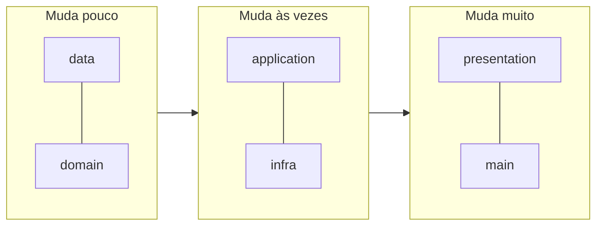

# 01 — Visão geral: a "Super Architecture"

**Fonte:** [`ddd-architecture.md`](../sources/design-architecture/ddd/ddd-architecture.md), [`ddd-architecture-layout-layers.md`](../sources/design-architecture/ddd/ddd-architecture-layout-layers.md).

A Super Architecture é a arquitetura de código backend da Super Frete. Segundo o doc, ela combina **DDD, Clean Architecture, Onion Architecture, Hexagonal Architecture e Vertical Slices**. Tudo gira em torno do **Domínio**.

## As camadas, de dentro para fora

Leitura das setas: **"pode importar de"**. As setas apontam sempre para dentro ou para um nível mais baixo. Isso é **derivado** das regras da seção [08](08-dependencias-e-nomenclatura.md).

## Em uma frase por camada

| Camada | Papel | Escopo |
|---|---|---|
| **data** | Código de mais baixo nível: tipos, enums, constantes, schemas | módulo |
| **domain** | Conhecimento do negócio, "o que o sistema é" | módulo |
| **infra** | Fala com o mundo externo (banco, filas, APIs) | módulo |
| **application** | Orquestra os casos de uso | módulo |
| **presentation** | Recebe requisição/mensagem e entrega à application | módulo |
| **main** | Sobe o sistema e liga as peças. É a única camada do nível do sistema, não do módulo | sistema |
| **building-blocks** | Blocos técnicos reutilizáveis entre módulos | sistema |
| **shared** | Recursos comuns que não couberam em outro lugar | sistema |

## Por que dividir assim?

**Fonte** (`ddd-architecture-layout.md`):

- **Camadas** servem para controle de dependências e para separar "o que muda menos" do "que muda mais".
- **Pastas** separam as "famílias" de código dentro de cada camada.

Quanto mais perto do centro, menos o código muda e menos ele sabe da tecnologia. Trocar Postgres por Mongo mexe em `infra`, não em `domain`.

## Benefícios declarados no doc

- **Centrada no domínio:** a lógica de negócio é a prioridade.
- **Alta coesão e baixo acoplamento:** facilita refatoração e testes.
- **Visão clara das responsabilidades:** ideal para equipes grandes e sistemas duradouros.
- **Foco em testes:** incentiva **testes de memória** pela alta cobertura e baixo esforço.
- **Resistência a mudanças tecnológicas:** troca de framework, banco ou interface sem quebrar o coração da aplicação.

## Pontos de observação (o próprio doc avisa)

- Herda a complexidade das arquiteturas que combina.
- Pode ter camadas redundantes se não for bem balanceada.
- Exige disciplina de time e governança arquitetural.
- Risco de "arquitetura por arquitetura".
- Pode ser difícil de adaptar em contexto de MVP.
- Precisa de uma equipe para cuidar da manutenção.

## Quando usar

- Lógica de negócio complexa e em evolução constante.
- Times que valorizam clareza de design e colaboração com especialistas do negócio.
- Sistemas que precisam de resiliência a longo prazo.

**Derivado:** para um CRUD simples ou um protótipo, o custo da estrutura provavelmente supera o benefício. O doc deixa isso implícito nos pontos de observação.

## Sobre a ordem "de dentro para fora"

Há duas respostas, e as duas estão corretas:

1. **Em termos de regra de negócio**, o **domain** é o núcleo. O próprio doc o chama de "domain (núcleo)".
2. **Em termos de dependência**, o **data** é ainda mais interno: tudo pode importar dele, e ele quase não importa nada. O domain depende do data (por exemplo, o `Postcode` usa o `postcodeSchema`).

Ordem completa: `data → domain → infra → application → presentation → main`.
