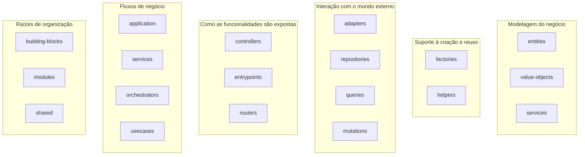

# 02 — Estrutura de pastas

**Fonte:** [`ddd-architecture-layout.md`](../sources/design-architecture/ddd/ddd-architecture-layout.md), [`ddd-architecture-layout-folders.md`](../sources/design-architecture/ddd/ddd-architecture-layout-folders.md), [`ddd-architecture-programming-paradigm.md`](../sources/design-architecture/ddd/ddd-architecture-programming-paradigm.md), [`ddd-architecture-main-layer.md`](../sources/design-architecture/ddd/ddd-architecture-main-layer.md).

> **Aviso:** as fontes **não trazem uma árvore de pastas oficial**. Ela é montada a partir da lista de camadas e dos caminhos que aparecem nos exemplos de código (`src/modules/...`, `src/building-blocks/...`, `src/main/...`). Por isso esta árvore é **derivada**.

## Árvore completa

```text
src/
├── main/                              ← nível do sistema
│   ├── entrypoints/                   ← aponta URL/mensageria para a presentation
│   │   ├── index.ts
│   │   └── router.ts
│   ├── hooks/                         ← ciclo de vida: warmup.ts, shutdown.ts, lifecycle.ts
│   ├── middlewares/
│   ├── app.ts
│   ├── boot.ts
│   └── server.ts
│
├── building-blocks/                   ← nível do sistema, reutilizável entre módulos
│   ├── data/                          ← contratos genéricos (HttpClient, Consumer, Ack, Nack...)
│   ├── adapters/                      ← implementações (axios, fetch, kafka, rabbitmq)
│   ├── factories/                     ← escolhe o adapter (ex.: CONSUMER_PROVIDER)
│   ├── entities/ value-objects/ schemas/ builders/ errors/   ← usados nos exemplos (ver erratas)
│
├── shared/                            ← o que não coube em outra camada
│
└── modules/
    └── <nome-do-modulo>/              ← ex.: freight, auth, routes, zones, status
        ├── data/                      ← type, enum, const, schema, contratos do módulo
        ├── domain/
        │   ├── value-objects/
        │   ├── entities/              ← aggregate e context ficam aqui (não têm pasta própria)
        │   ├── services/              ← domain service
        │   ├── factories/             ← domain factory
        │   ├── helpers/               ← evite usar
        │   └── mappers/               ← (nome da pasta inferido do título "Mapper (folder)")
        ├── infra/
        │   ├── adapters/
        │   ├── repositories/          ← prisma/, memory/ ...
        │   ├── queries/
        │   ├── mutations/
        │   └── factories/
        ├── application/
        │   ├── services/
        │   ├── orchestrators/
        │   ├── usecases/
        │   ├── controllers/
        │   ├── handlers/
        │   └── factories/             ← usecases.ts, handlers.ts, controllers.ts
        └── presentation/
            ├── http/                  ← routers (a doc também chama de "API")
            └── messaging/             ← consumers
```

## O mapa mental: "camada" x "pasta"

| Conceito | Pergunta que responde | Exemplo |
|---|---|---|
| **Camada** | "O quanto isto muda e de quem pode depender?" | `domain`, `infra` |
| **Pasta** | "Que família de código é esta?" | `entities`, `repositories` |

Em `ddd-architecture-layout-folders.md` as pastas são agrupadas por afinidade:



## Quem fica fora de `modules`

Segundo a lista de camadas, estas ficam no nível do sistema, não de um módulo:

- **main**: "é a única camada que funciona a nível do sistema e não do módulo".
- **building-blocks** e **shared**.

A `presentation` aparece como camada de módulo no doc de camadas (`modules/<x>/presentation/...` nos exemplos) e também na lista do layout como camada do sistema. **Veja a errata** em [13](13-erratas-das-fontes.md).

## Exemplos reais de caminho, tirados das fontes

| Arquivo | Caminho citado |
|---|---|
| Usecase | `src/modules/freight/application/usecases/create-freight.ts` |
| Controller factory | `src/modules/freight/application/factories/...` |
| Handler | `src/modules/freight/application/handlers/freight.ts` |
| Orchestrator | `src/modules/delivery/application/orchestrators/dispatch-delivery.ts` |
| Repository (Prisma) | `src/modules/users/infra/repositories/prisma/user.ts` |
| Repository (memória) | `src/modules/users/infra/repositories/memory/user.ts` |
| Contrato de repository | `src/modules/users/data/repositories-data.ts` |
| Router HTTP | `src/modules/status/presentation/http/status-http.ts` |
| Consumer | `src/modules/freight/presentation/messaging/consumers.ts` |
| Entrypoint | `src/main/entrypoints/router.ts` |
| Adapter genérico | `src/building-blocks/adapters/http/axios-http-adapter-block.ts` |
| Contrato genérico | `src/building-blocks/data/http-data-block.ts` |
| Factory genérica | `src/building-blocks/factories/consumer-factory-block.ts` |

## Estrutura do `main` (citada literalmente)

```text
src/
 ── main/
    └── middlewares/
    └── entrypoints/
        └── index.ts
        └── router.ts
    └── hooks/
        └── shutdown.ts
        └── warmup.ts
    └── app.ts
    └── boot.ts
    └── server.ts
```
