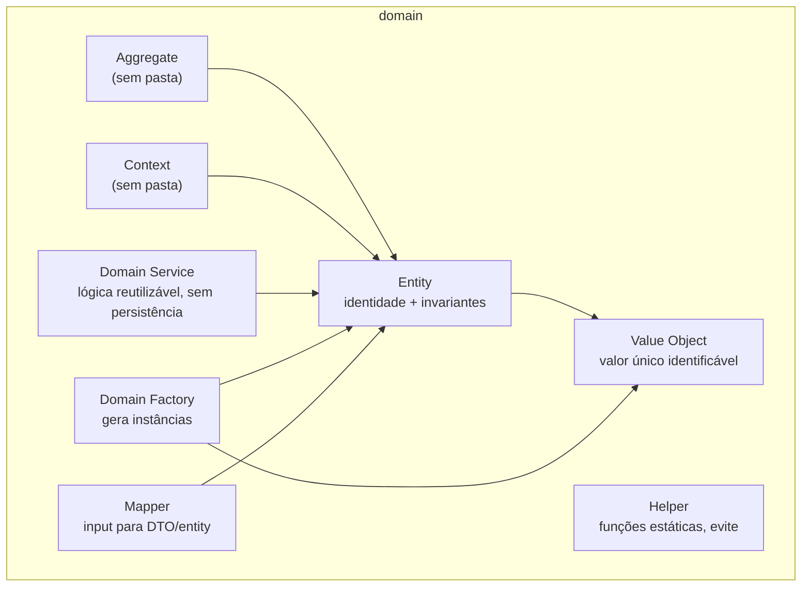
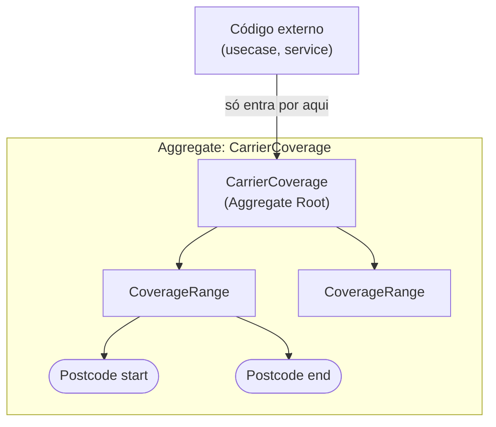
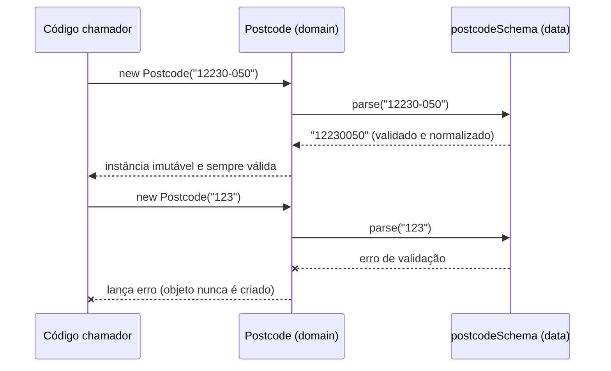
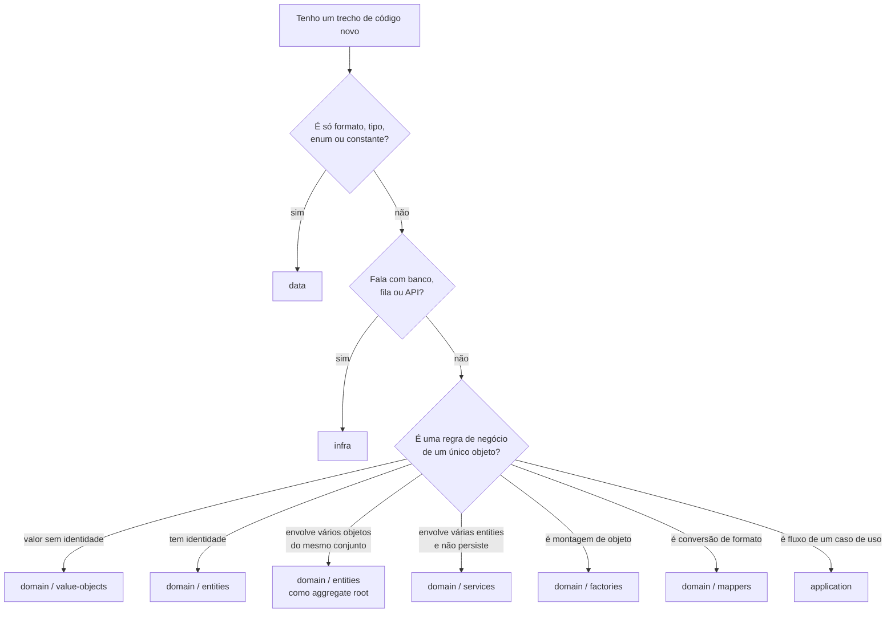

# 03 — Data e Domain (o núcleo)

**Fontes:** [`ddd-architecture-data-layer.md`](../sources/design-architecture/ddd/ddd-architecture-data-layer.md), [`ddd-architecture-domain-layer.md`](../sources/design-architecture/ddd/ddd-architecture-domain-layer.md) e as subpastas `domain-layer-*-folder.md`.
**Exemplo executável:** [`examples/carrier-coverage-ddd`](../examples/carrier-coverage-ddd).

---

# Parte 1 — Camada Data

> "Onde centralizamos os códigos de mais baixo nível possível, tais como: enum, interfaces, types, constants, schemas, etc." — `ddd-architecture-data-layer.md`

## Regras (Fonte)

1. Contém **apenas valores imutáveis e constantes**. "Nunca implementações de processamento."
2. **Todas as camadas podem importar dela**, e ela só pode importar tipagem.
3. Bônus: pode ser exportada como *package* para outros projetos da empresa validarem tipagem no CI/CD (estratégia de *bounded contexts*).

## O que cabe nela

| Item | Exemplo das fontes |
|---|---|
| Constante | `export const REDIS_PREFIX = "redis";` |
| Enum | `PEGAKI_STATE_CODE { CREATED, CANCELLED, POSTED_IN_LOCATION, COLLECTED_FROM_LOCATION }` |
| Interface / type | `interface Metadata { createdAt: Date; updatedAt?: Date; deletedAt?: Date ... }` |
| Schema (zod) | `locationSchema`, `geolocationSchema`, `addressSchema` |
| Contrato de infra | `interface UserRepository { findById(id); save(user) }` |
| Contrato genérico | `interface Consumer`, `interface HttpClient`, `type Ack`, `type Nack` (em `building-blocks/data`) |

## Exemplo: schema + tipo derivado

```ts
// modules/<x>/data/geolocation-data.ts
import { z } from 'zod'

export const geolocationSchema = z.object({
  latitude: z.number(),
  longitude: z.number(),
})

export type GeolocationProps = z.infer<typeof geolocationSchema>
```

O `schema` define o formato **e** gera o tipo TypeScript. Uma só fonte de verdade para validação e tipagem.

## O que Data NÃO é

| Não é | Porque |
|---|---|
| Regra de negócio | "um endereço precisa de ao menos um valor" é regra de formato, vale. "uma faixa não pode se sobrepor" é regra de negócio, vai para o domain |
| Acesso a banco | O nome engana. A fonte usa "data" no sentido de **tipagem e arquivos estáticos**, não de persistência |

## A visão própria deles

O doc compara como cada arquitetura entende "data" e escolhe uma:

| Arquitetura | Onde fica o "data" |
|---|---|
| DDD | Parte da infraestrutura |
| Clean Architecture | Implementações de baixo nível (mappers, schemas, DTOs) |
| Onion Architecture | Nas bordas |
| **A deles** | **Clean Architecture: código de mais baixo nível possível, como tipagem e arquivos estáticos** |

---

# Parte 2 — Camada Domain

> "Focado na modelagem do negócio, é a camada mais pura, que contém implementações unitárias e de baixo nível. [...] O código aqui representa o que o sistema 'é', não como ele se conecta ou opera tecnicamente." — `ddd-architecture-domain-layer.md`

## As oito peças



| Peça | Definição (citação do `layout.md`) | Tem pasta? |
|---|---|---|
| **Value Object** | "Classe que possui um valor único identificável (cep, address, etc)" | sim |
| **Entity** | "Classe com propriedades e comportamentos para controle de invariâncias" | sim |
| **Aggregate** | "Sem pasta. Agregados são entidades que lidam com outras entidades" | **não** |
| **Context** | "Sem pasta. São entidades ou agregados que controlam dados comum" | **não** |
| **Domain Service** | "Classe reusável com foco em código de baixo nível e sem persistência" | sim |
| **Domain Factory** | "Classe geradora de instâncias e controle de dependências" | sim |
| **Helper** | "Contém funções estáticas e de baixo nível. Evite usar" | sim |
| **Mapper** | "Transforma dados de um input para um DTO ou entidade (preferencialmente)" | sim |

## 2.1 Value Object

**Fonte:** `ddd-architecture-domain-layer-value-object-folder.md`

Estrutura **imutável** que representa um conceito com valor próprio, **sem identidade**, comparada pelo **conteúdo**.

Características listadas: código de baixo nível, imutabilidade, igualdade por atributos, sem identidade, **auto-validado**.

Benefícios: regras de negócio encapsuladas, validação centralizada, menos duplicação, fácil de testar isoladamente.

### Padrão de código das fontes

Todos os value objects das fontes seguem o mesmo molde:

```ts
export class Geolocation {
  #data: GeolocationProps                       // campo privado
  constructor(private readonly props: GeolocationProps) {
    this.#data = geolocationSchema.parse(this.props)   // nasce validado
  }
  public get data(): Readonly<GeolocationProps> {      // leitura imutável
    return this.#data
  }
  get value(): string {                                // forma canônica
    return `${this.#data.latitude},${this.#data.longitude}`
  }
  public toJSON(): Readonly<GeolocationProps> {        // serialização
    return this.#data
  }
}
```

Os quatro pontos do molde: **`#` privado**, **schema no constructor**, **getter `Readonly`**, **`toJSON()`**.

### Exemplo mínimo (CEP)

```ts
export class PostCode {
  #value: string
  constructor(payload: string) {
    if (!/^\d{5}-?\d{3}$/.test(payload)) throw new Error('Invalid postcode')
    this.#value = payload.replace('-', '')
  }
  public get value(): string { return this.#value }
}
```

> O trecho original usa `postCode.replace(...)`, uma variável inexistente (o parâmetro é `payload`). Corrigido aqui. Veja [13](13-erratas-das-fontes.md).

## 2.2 Entity

**Fonte:** `ddd-architecture-domain-layer-entity-folder.md`

Conceito do domínio com **identidade única**, reconhecida por essa identidade e **não pelos atributos**. Encapsula comportamento e regras que **mudam ao longo do tempo**, preservando a consistência interna. Normalmente usa Value Objects e validação por schema.

Características: rastreabilidade, consistência, encapsulamento, flexibilidade, testabilidade.

### Entity x Value Object (tabela da fonte)

| | Entity | Value Object |
|---|---|---|
| **Identidade** | única e imutável | igualdade por atributos |
| **Ciclo de vida** | pode mudar de estado | imutável |
| **Comparação** | por ID | por valores |
| **Uso** | algo que evolui no tempo | característica ou descrição |
| **Persistência** | precisa ser rastreada | pode ser recriada |

### Como o `id` aparece nas fontes

O `id` pode ser **derivado** do conteúdo, via um Value Object próprio:

```ts
get id(): string {
  return new RouteId({
    origin: new Routing(this.#data.origin),
    destiny: new Routing(this.#data.destiny),
  }).value                         // "FROM|a-b|TO|c-d"
}
```

## 2.3 Aggregate (sem pasta)

**Fonte:** mesmo arquivo da Entity.

> "Composição de entities e value-objects que formam uma **unidade de consistência e integridade** dentro do domínio. Ele é acessado sempre a partir de uma **entidade raiz (Aggregate Root)**, responsável por coordenar as mudanças e garantir as invariantes do conjunto."

Efeitos listados: limita o escopo das transações, reduz acoplamento, preserva a coesão.



Regra prática: **a invariante vive no menor objeto que tem informação suficiente para garanti-la.**

| Invariante | Quem garante | Por quê |
|---|---|---|
| "CEP tem 8 dígitos" | `Postcode` (VO) | Só precisa do próprio valor |
| "start não passa de end" | `CoverageRange` (Entity) | Só precisa dos próprios campos |
| "nenhuma faixa se sobrepõe" | `CarrierCoverage` (Root) | Precisa enxergar **todas** as faixas |

## 2.4 Context (sem pasta)

A fonte só define: "entidades ou agregados que controlam dados comum". **Não há exemplo de código** no domain. Nos exemplos de application aparece `CtxAuth` / `Ctx` (contexto de autenticação com sessão, usuário e `ability()` de permissões). Isso é **derivado**; confirme com o Jefferson.

## 2.5 Domain Service

**Fonte:** `ddd-architecture-domain-layer-service-folder.md`

Executa ações ou coordena processos que envolvem **mais de uma Entity**, ou regras que não cabem em Value Objects. Mantém o domínio "limpo e expressivo, separando comportamentos de dados".

Características: regras de negócio **puras**, **stateless**, operam com objetos do domínio, e às vezes expressam **Behavioral Design Patterns**. Processamento reusável de baixo nível, **sem interação com o mundo externo**.

### Exemplo da fonte: Strategy dentro do Domain Service

```ts
class FreightCalculationService {
  constructor(
    private readonly distanceStrategy: DistanceCalculationStrategy,
    private readonly pricePerKm: number = 2.5,
  ) {}
  calculateFreight(origin: Address, destination: Address, weight: Weight) {
    const distance = this.distanceStrategy.calculate(origin, destination)
    const basePrice = distance * this.pricePerKm
    const weightFactor = this.calculateWeightFactor(weight)
    return { distance, basePrice, finalPrice: basePrice * weightFactor,
             estimatedTime: this.calculateEstimatedTime(distance) }
  }
}
// estratégias: HaversineDistanceStrategy, GoogleMapsDistanceStrategy
```

Note a conexão: o service é do **domain**, a estratégia vem do padrão **Strategy** ([10](10-design-patterns.md)).

## 2.6 Domain Factory

**Fonte:** `ddd-architecture-factory-folder.md`

"Classe geradora de instâncias e controle de dependências." Duas variantes são recomendadas:

| Variante | Quando usar (Fonte) |
|---|---|
| **Factory Method** | Instanciar uma "família customizada" que foge de nomenclaturas conhecidas em arquiteturas. Ex.: *Freight* é uma família do negócio |
| **Abstract Factory** | Instanciar famílias de código **arquiteturais** (usecases, controllers) |

Detalhes de cada uma em [10](10-design-patterns.md).

## 2.7 Mapper

**Fonte:** `ddd-architecture-domain-layer-mapper-folder.md`

Transforma dados de uma estrutura de origem para outra, "ajustando nomes, tipos e valores de acordo com um modelo de destino pré-definido". Exemplo da fonte: `contentDeclarationMapper`, que recebe array ou objeto de declarações e devolve `{ description, quantity, amount }` agregados.

## 2.8 Helper

**Fonte:** `ddd-architecture-domain-layer-helper-folder.md`

Funções utilitárias pequenas e unitárias. O layout avisa: **"Evite usar"**. Exemplo da fonte: `limitDescriptionDeclaredValue(description)`, que corta o texto no limite máximo.

**Derivado:** se o helper opera sobre um conceito do negócio, provavelmente é método de um Value Object ou Entity.

---

# Parte 3 — Data e Domain trabalhando juntas



O schema (data) descreve **o formato**. O Value Object (domain) **impõe** o formato e acrescenta **comportamento** (`isBefore`, `isAfter`, `isEqual`).

## Checklist: onde coloco isto?



## Exercício guiado

Abra [`examples/carrier-coverage-ddd`](../examples/carrier-coverage-ddd) e responda, antes de olhar a resposta:

1. Qual arquivo é Data e por quê?
2. Por que `overlaps` está em `CoverageRange` mas a **rejeição** da sobreposição está em `CarrierCoverage`?
3. O que acontece se você tentar criar `new Postcode("1234")`?
4. Por que `ranges` devolve uma cópia?
