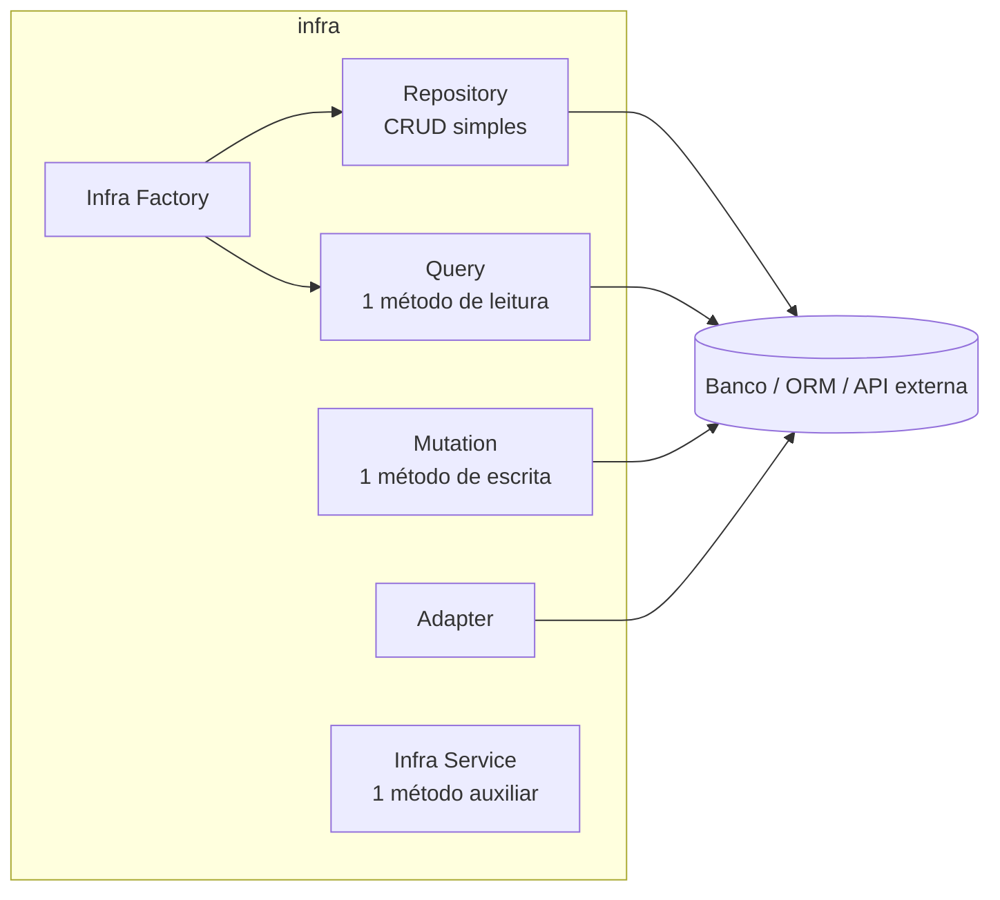
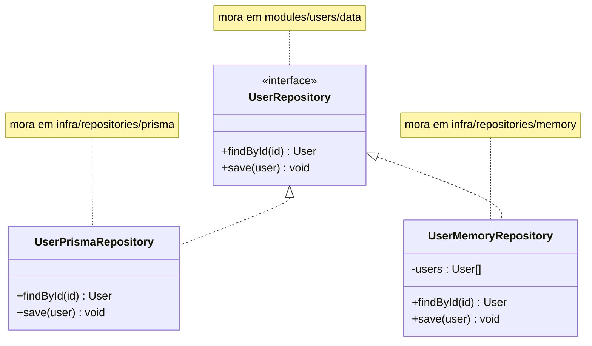
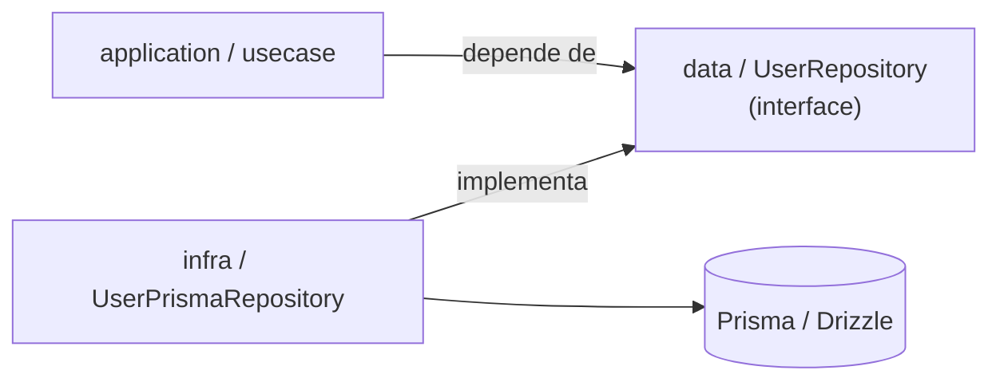

# 04 — Infra

**Fontes:** [`ddd-architecture-infra-layer.md`](../sources/design-architecture/ddd/ddd-architecture-infra-layer.md) e as subpastas `infra-layer-*-folder.md`.

> "A Infra serve como ponte entre o domínio e recursos externos, cuidando da implementação técnica que não pertence diretamente à lógica de negócio. [...] É o elo entre o domain e application."
>
> "Obs: infra é uma camada de solução arquitetural de business que **pode importar de domain mas não de application**."

## Peças



## Repository

**Fonte:** `infra-layer-repository-folder.md`

Abstrai o acesso a dados, isolando a persistência do restante. Faz **CRUD** e outras operações unitárias (`activate`, `disable`).

**Quando usar:** manter o domínio independente da tecnologia de persistência, ter testabilidade sem banco real, e organizar bem por camadas.

### Contrato (em `data`) + duas implementações (em `infra`)



```ts
// src/modules/users/infra/repositories/memory/user.ts
export class UserMemoryRepository implements UserRepository {
  private users: User[] = []
  async findById(id: string): Promise<User | null> {
    return this.users.find((user) => user.id === id) ?? null
  }
  async save(user: User): Promise<void> {
    const index = this.users.findIndex((u) => u.id === user.id)
    if (index >= 0) this.users[index] = user   // update
    else this.users.push(user)                 // insert
  }
}
```

A implementação em memória é a base dos **testes de memória** ([09](09-testes.md)).

## Query (leitura) e Mutation (escrita)

**Fontes:** `infra-layer-query-folder.md`, `infra-layer-mutation-folder.md`

Ambas são **Repository com método único** (`execute`), inspiradas no **CQRS** ([11](11-cqrs-e-event-sourcing.md)).

| | Query | Mutation |
|---|---|---|
| Papel | Lado de leitura | Lado de comando (escrita) |
| Altera estado? | **Não** | **Sim** |
| Retorna | Agregados ou DTOs (DTO em grande volume) | Só quando necessário: ids, status, eventos |
| Use quando | Leitura com várias tabelas (joins, denormalização, cache) | Escrita condicional, entidades compostas, validação antes de persistir, eventos |
| Transação | não | **comum** (`Transaction/Commit/Rollback`) |

### Exemplos citados

- `AuthUserDrizzleQuery`: um `SELECT` com `leftJoin` de membros, tenants e organizações, agregados em JSON, e `NotFoundError` quando não acha.
- `AuthAccountCreateDrizzleMutation`: cria user, tenant, organização e member **numa transação** (`orm.transaction`).

O padrão de nome é `<Contexto><Ação><Tecnologia><Tipo>`: `AuthAccountCreate` + `Drizzle` + `Mutation`.

## Adapter

**Fonte:** `infra-layer-adapter-folder.md`

Conecta o mundo externo à aplicação, mantendo o domínio isolado de detalhes técnicos. Implementa ou consome interfaces do domínio ou da application, sem alterar a lógica de negócio.

Características:
- Dois modelos: **herança** vs **composição**.
- Dois sentidos: **inbound** e **outbound**.
- Dois tipos: **adapter de classe** e **adapter de objeto**.

Mais detalhes no padrão Adapter em [10](10-design-patterns.md) e em `sources/design-patterns/docs/design-patterns-structural-adapters.md`.

## Infra Factory

**Fonte:** `infra-layer-factory-folder.md`

Constrói componentes de infraestrutura. Exemplos:

```ts
export class FreightMemoryRepositoryFactory implements FreightRepositoryFactory {
  constructor(private readonly orm: Orm) {}
  freight(ctx: CtxAuth) {
    return new FreightMemoryRepository(ctx, this.orm)
  }
}
```

A **mesma interface** (`FreightRepositoryFactory`) tem uma versão de memória e uma de banco. Trocar uma pela outra é decisão de quem monta o sistema (`main`).

## Infra Service

"Classe com único método para auxílio da infra" (do `layout.md`). Não há exemplo de código nas fontes.

## Como infra respeita a inversão de dependência



O usecase **nunca importa** a classe concreta. Ele conhece só o contrato em `data`. Quem escolhe a implementação é a factory, chamada pelo `main`.
