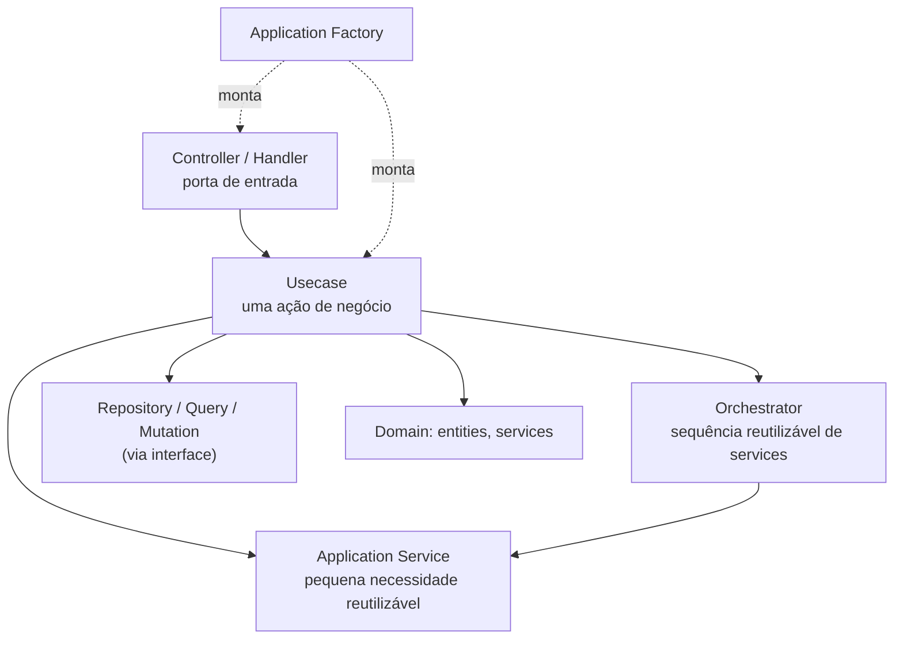
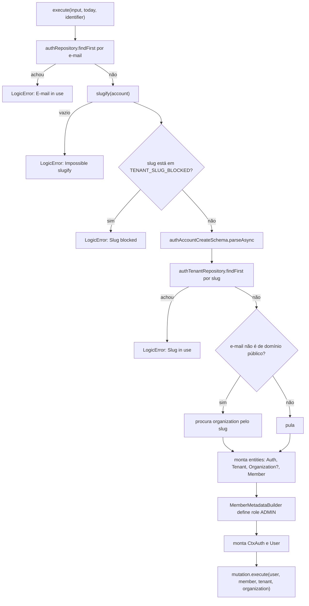
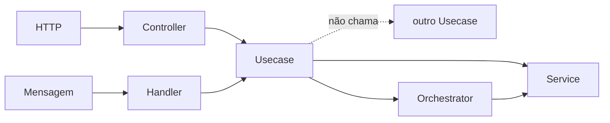

# 05 — Application

**Fontes:** [`ddd-architecture-application-layer.md`](../sources/design-architecture/ddd/ddd-architecture-application-layer.md) e as subpastas `application-layer-*-folder.md`.

> "Ela é responsável por orquestrar os casos de uso da aplicação, ou seja, coordenar como os componentes do sistema interagem para atender uma necessidade de negócio."

## O que a camada faz e não faz

| Faz | Não faz |
|---|---|
| Coordena a execução de casos de uso específicos | Não implementa regras de negócio complexas (é do domínio) |
| Orquestra Services, Orchestrators, Repositories, Queries, Mutations e domínios | Não acessa banco diretamente (é da infra) |
| Aplica regras de aplicação (ex.: "após criar um frete, envie um evento") | Não contém lógica de exibição |
| Separa o contexto entre infraestrutura e domínio | |

## Os três níveis de orquestração

**Fonte:** `application-layer-orchestrator-folder.md`

| Papel | Responsabilidade | Nível |
|---|---|---|
| **Service** | Coordena pequenas necessidades da aplicação | Baixo |
| **Orchestrator** | Coordena múltiplas necessidades de serviço | Médio |
| **Use Case** | Orquestra uma ação de negócio específica | Alto |



## Usecase

**Fonte:** `application-layer-usecase-folder.md`

Uma ação de negócio específica, em resposta a uma intenção do usuário ou de um sistema externo. Exemplos citados: `CreateFreightUseCase`, `UpdateFreightStatusUseCase`, `CalculateRouteUseCase`, `GetFreightDetailsUseCase`.

Características:
- **Unitária e autocontida:** executa uma ação única e clara.
- Sem dependência direta da infraestrutura, **apenas via interfaces**.
- Pode retornar entidades, agregados, DTOs, eventos de domínio ou um resultado simples.
- Facilita testes unitários.

> **Regra da fonte: "Um Use Case não pode chamar outro Use Case!"**
> Quando dois usecases precisam da mesma sequência, essa sequência vira um **Orchestrator** ou **Service** reutilizado pelos dois.

### Exemplo mínimo

```ts
export class CreateFreightUsecase {
  constructor(private readonly mutation: RegisterFreightMutation) {}
  async execute(entity: Freight): Promise<{ id: string }> {
    return await this.mutation.execute(entity)
  }
}
```

### Exemplo completo: `AuthAccountCreateUseCase`

O exemplo mais longo das fontes mostra o fluxo real de um usecase:



O usecase faz **verificações de unicidade via Repository**, **instancia entities** (que validam a si mesmas) e **entrega tudo a uma Mutation**, que persiste em uma transação.

## Application Service

**Fonte:** `application-layer-service-folder.md`

Orquestra um processo de negócio coordenando entidades para reaproveitar lógica, "muitas das vezes seguindo algum Behavior Design Pattern". Vários Services podem ser usados num Orchestrator, ou diretamente num Usecase.

Não faz: regras de domínio (cálculos), HTTP/REST/gRPC, acesso direto à infra, nem assume o papel de usecase, query, mutation ou repository.

Exemplo: `CryptService` com `generate(input)` (salt + hash) e `compare(input, hashed)`, recebendo um contrato `Crypt`.

## Orchestrator

**Fonte:** `application-layer-orchestrator-folder.md`

Coordena **múltiplas ações ou serviços em sequência lógica**. Use quando precisar de: sequência com lógica condicional, reaproveitar uma sequência ordenada, ou quando vários usecases têm uma necessidade comum repetida.

Vantagens: centraliza processos reusáveis, permite compensações e tratamento de falhas em nível de processo, funciona bem com mensageria. **Pode ser usado com uma estratégia de Design Pattern.**

> Não contém lógica de negócio. "Ele coordena ações, não implementa regras."

```ts
export class DispatchDeliveryOrchestrator {
  constructor(
    private readonly notifyClient: NotifyClientService,
    private readonly startTracking: StartTrackingUseCase,
    private readonly logEvent: LogFreightHistoryUseCase,
  ) {}
  async execute(freightId: string): Promise<void> {
    await this.notifyClient.send(freightId, 'Your freight is on the way')
    await this.startTracking.execute(freightId)
    await this.logEvent.execute({ freightId, type: 'STARTED_DELIVERY', timestamp: new Date() })
  }
}
```

> Note: este exemplo injeta `StartTrackingUseCase` e `LogFreightHistoryUseCase` dentro de um Orchestrator, o que parece conflitar com a regra "Use Case não chama Use Case". O orchestrator **não é** um usecase, mas vale perguntar ao Jefferson. Registrado em [13](13-erratas-das-fontes.md).

## Controller

**Fonte:** `application-layer-controller-folder.md`

Porta de entrada para requisições externas (HTTP, gRPC, WebSocket). **Delega a um usecase** e devolve a resposta.

| Faz | Não faz |
|---|---|
| Recebe requisições externas | Lógica de negócio |
| Converte input (JSON, params, body) em DTOs ou comandos | Acesso direto a banco |
| Chama um usecase | Instanciar entidades ou fazer cálculos complexos |
| Trata erros e respostas | |

No exemplo `AuthInviteUserToTenantController`: valida o input com **zod**, verifica **permissões** (`ability().throwUnlessCan`), monta o usecase via **factories** e devolve `toJSON()` das entidades.

## Handler

**Fonte:** `application-layer-handle-folder.md`

O "Controller do mundo assíncrono": trata mensagens de fila, evento ou stream (Kafka, RabbitMQ, SQS).

| Característica | Controller | Handler |
|---|---|---|
| Entrada | HTTP request | Mensagem da fila/evento |
| Saída | HTTP response | Ack/Nack (ou nenhuma) |
| Lida com | Rotas e verbos HTTP | Tópicos, filas, eventos |
| Responsável por | Validar, encaminhar fluxo | Validar, tratar evento assíncrono |
| Chama | Use Case | Use Case |

Deve: receber o payload, validar (schema), verificar permissões, lidar com nack/dead-letter, chamar o caso de uso, confirmar ou rejeitar (ack/nack), garantir **idempotência**.
Não deve: conter lógica de negócio, depender direto de brokers/drivers, acessar o banco.

```ts
async handle(message: any, ack: Ack, nack: Nack): Promise<void> {
  try {
    if (!message.freightId || !message.newStatus) throw new Error('Invalid message format')
    await this.freightUsecasesFactory.freight().execute(message.freightId, message.newStatus)
    ack()
  } catch (error) {
    console.error('Error processing message:', error)
    nack(false)
  }
}
```

## Application Factory

**Fonte:** `application-layer-factory-folder.md`

Encapsula a construção dos componentes da aplicação (usecases, handlers, orchestrators). Centraliza a composição de dependências para que o resto do sistema apenas peça "instâncias prontas".

Vantagens: organiza o processo num lugar só, **separa composição (injeção) de execução**, facilita teste e mock, e permite alternar implementações (memória ou banco real).

```ts
export class RoutesUseCasesFactories {
  constructor(private readonly routesRepositoriesFactories: RoutesRepositoriesFactories) {}
  getRoute(): GetRouteUseCase {
    return new GetRouteUseCase(this.routesRepositoriesFactories.route())
  }
  listRoutes(): ListRoutesUseCase {
    return new ListRoutesUseCase(this.routesRepositoriesFactories.route())
  }
}
```

## Resumo visual: quem chama quem


