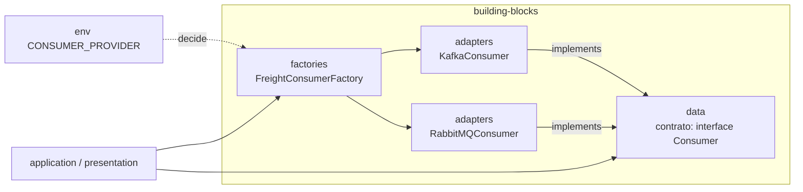

# 06 — Presentation, Main e Building blocks

**Fontes:** `ddd-architecture-presentation-layer*.md`, `ddd-architecture-main-layer*.md`, `ddd-architecture-building-blocks-layer*.md`.

---

# Presentation

> "A interface pública do sistema. [...] Responsável por receber requisições externas, interpretá-las e encaminhar o fluxo de execução para as camadas internas da aplicação — como controllers e handlers."

Responsabilidades: receber a entrada (requisição ou mensagem), chamar o que for necessário na application, e retornar/emitir respostas, status ou eventos.

Vantagem: trocar API, fila ou CLI sem tocar no core. Duas pastas: **http** (a doc também chama de "API") e **messaging**.

## Http / Router

**Fonte:** `presentation-layer-http-folder.md`

Um **Router** agrupa endpoints HTTP **por módulo**, define os caminhos da API e encaminha para os Controllers. Cada módulo expõe seu próprio router (escalável) e o framework web pode ser trocado dentro da `HttpFactory` (plugável).

```ts
// src/modules/status/presentation/http/status-http.ts
const controller = StatusControllersFactory.http()
export const statusRouter = HttpAdapter.router()

statusRouter.get('/v1', controller.get.bind(controller))
```

## Messaging / Consumer

**Fonte:** `presentation-layer-messaging-folder.md`

O **Consumer** é o equivalente ao Controller para filas/tópicos: "no HTTP você escuta endpoints; na mensageria, o Consumer escuta filas, tópicos ou canais".

| Tipo | Exemplo |
|---|---|
| Command Consumer | Mensagem que indica uma ação (criar pedido) |
| Event Consumer | Mensagem que representa um fato ocorrido (pedido pago) |
| Stream Consumer | Processamento contínuo de alto volume (logs, sensores) |

Boas práticas: isolar lógica de domínio, **validar a entrada mesmo vinda da fila**, tratar erros (retry, nack, dead-letter), registrar logs e métricas, garantir **idempotência**.

```ts
export async function freightConsumer() {
  await channel.connect()
  channel.consume('freight-status-updated', handler.handle.bind(handler))
}
```

---

# Main

**Fonte:** `main-layer.md`, `main-layer-entrypoint-folder.md`, `main-layer-hook-folder.md`

A camada mais externa. Inspirada no "main" de Uncle Bob (Clean Architecture): **composition root**.

- **Compõe** a aplicação: configura e conecta as dependências entre as camadas.
- **Inicia** servidores e listeners (HTTP, gRPC, CLI).
- **Adapta** a aplicação ao mundo externo (Express, Fastify, NestJS, banco, filas).
- "Apenas liga as peças (sem regras de negócio)."
- "Depende das outras camadas, mas **nenhuma camada deve depender dela**."

## Entrypoint

Primeiro componente que recebe uma solicitação externa. Só **aponta uma URL ou mensageria para a próxima camada**.

| Tipo de aplicação | Entrypoint típico |
|---|---|
| API REST | Controller |
| CLI | Comando ou `main.ts` |
| Worker (fila/eventos) | Consumer de mensagem |
| GraphQL | Resolver ou handler |
| Microservice (HTTP/gRPC) | Handler da interface remota |
| Serverless | Função `handler()` |

Não faz: lógica de negócio, acesso a banco, nem conhece detalhes do domínio.

```ts
// src/main/entrypoints/router.ts
const router = HttpAdapter.router()
router.use('/status', statusRouter)
```

## Hook

Funções que controlam o **ciclo de vida** da aplicação: inicialização, desligamento, monitoramento.

Vantagens: evita *race conditions* no boot, evita perda de dados ao encerrar, facilita observabilidade, dá suporte a *warmups* serverless e a *readiness/liveness* do Kubernetes. Arquivos sugeridos: `warmup.ts`, `shutdown.ts`, `lifecycle.ts`.

---

# Building blocks

**Fonte:** `building-blocks-layer.md` e subpastas `adapter`, `data`, `factory`.

Blocos de construção **reutilizáveis** da aplicação: a fundação técnica, que "não pertence a nenhum domínio específico (como frete, pagamento, usuário)".

Coloque aqui o que for **reutilizável entre múltiplos domínios**, **independente de negócio** e **técnico ou de suporte**.

| Benefício | Por quê? |
|---|---|
| Reuso | Um único adapter ou factory serve a todos os módulos |
| Centralização | Decisões técnicas num só lugar |
| Baixo acoplamento | Domínios não sabem qual lib é usada |
| Alta testabilidade | Fácil mockar contratos (`HttpClient`, `Publisher`) |
| Portabilidade | Trocar Kafka ↔ RabbitMQ sem reescrever o sistema |
| Escalabilidade | Novas integrações mantendo o padrão |

## As três pastas e como se ligam



- **data:** o "o quê". `interface HttpClient { get(url); post(url, body) }`.
- **adapters:** o "como". `AxiosAdapter`, `FetchAdapter`, `KafkaConsumer`, `RabbitMQConsumer`.
- **factories:** escolhe qual usar. Atua como **Service Locator**, centraliza a decisão por tecnologia e garante **Singleton** da instância (variável `let channel` no módulo).

Trocar Kafka por RabbitMQ exige só mudar a variável de ambiente `CONSUMER_PROVIDER`.

---

# Shared

"Contém recursos comum que não couberam em outra camada ou pasta." Nenhum outro detalhe nas fontes.
