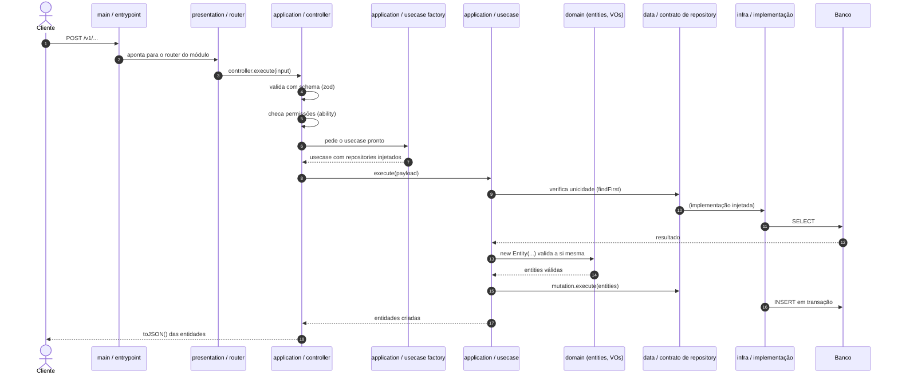
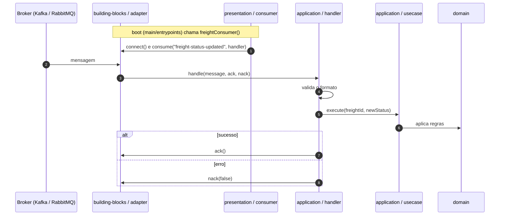
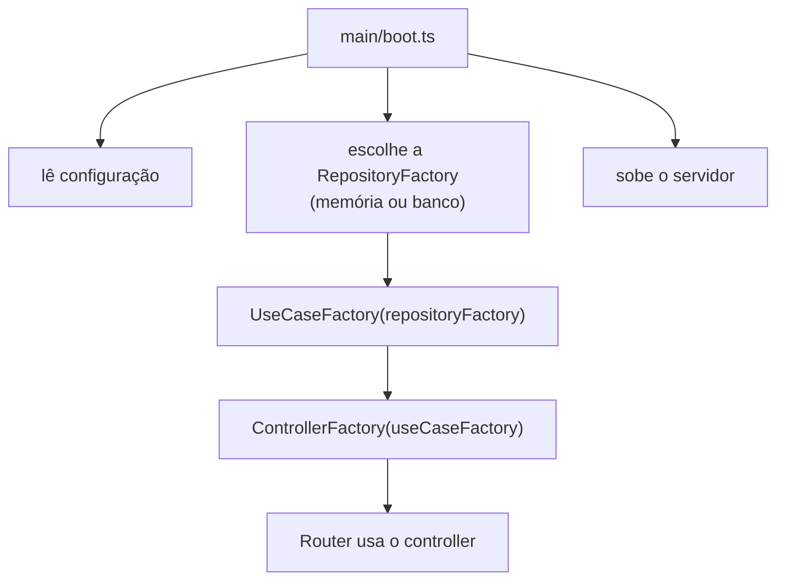

# 07 — Fluxo de uma requisição (juntando tudo)

> **Derivado.** Cada passo vem de um doc de camada, mas a sequência completa não está escrita em um único lugar nas fontes. Ela foi montada ligando os exemplos de Controller, Usecase, Mutation, Handler e Consumer.

## Fluxo HTTP

### Quem faz o quê

| Passo | Camada | Responsabilidade |
|---|---|---|
| 1-2 | main | Recebe e aponta |
| 3 | presentation | Agrupa rotas por módulo |
| 4-6 | application (controller) | Valida entrada, permissões, monta o usecase |
| 7-8 | application (factory) | Composição de dependências |
| 9-13 | application (usecase) + infra | Regra de aplicação e leitura |
| 14-15 | **domain** | Regras de negócio: entidades que se validam |
| 16-17 | application + infra | Persistência atômica |
| 18 | application (controller) | Serializa a resposta |

O ponto central: **as regras de negócio (14-15) acontecem no domínio**, sem saber que existe HTTP ou banco.

## Fluxo de mensageria

## Quem monta tudo? O `main`

Nos **testes**, o equivalente do `main` monta tudo com `MemoryRepositoryFactory`, sem banco e sem servidor. Esse é o "teste de memória" que o doc de visão geral cita.
