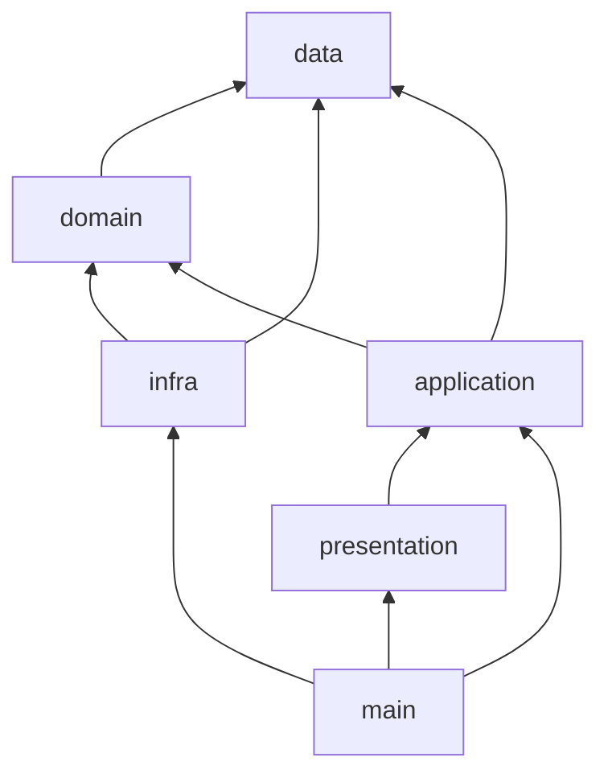
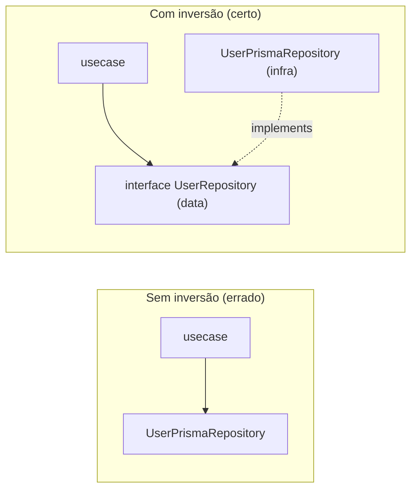

# 08 — Dependências e nomenclatura

## Regras de dependência

### O que as fontes dizem explicitamente

| Regra | Fonte |
|---|---|
| "**Todas as camadas podem importar** de `data`, e ela só pode importar tipagem." | `data-layer.md` |
| "`infra` pode importar de `domain` mas **não de `application`**." | `infra-layer.md` |
| "`main` depende das outras camadas, mas **nenhuma camada deve depender dela**." | `main-layer.md` |
| Use Case "não tem dependência direta da infraestrutura, **apenas via interfaces**." | `application-layer-usecase-folder.md` |
| Adapter "implementa contratos definidos na pasta `data`". | `building-blocks-layer-adapter-folder.md` |
| O domain "representa o que o sistema é, **não como ele se conecta ou opera tecnicamente**". | `domain-layer.md` |
| "Um Use Case **não pode chamar outro** Use Case!" | `application-layer-usecase-folder.md` |

### Matriz derivada

Quem **pode** importar de quem. **Derivado** das regras acima e dos imports dos exemplos de código.

| Origem ↓ / Destino → | data | domain | infra | application | presentation | main | building-blocks |
|---|:-:|:-:|:-:|:-:|:-:|:-:|:-:|
| **data** | tipos | não | não | não | não | não | não |
| **domain** | sim | sim | não | não | não | não | sim |
| **infra** | sim | sim | sim | **não** | não | não | sim |
| **application** | sim | sim | via contrato em data | sim | não | não | sim |
| **presentation** | sim | evitar | não | sim | sim | não | sim |
| **main** | sim | sim | sim | sim | sim | sim | sim |



### Inversão de dependência, passo a passo



No "antes", trocar o banco obriga a mexer no usecase. No "depois", o usecase não muda.

## Padrão de nomenclatura (Fonte: `naming-standard.md`)

| Elemento | Padrão | Exemplos |
|---|---|---|
| Variáveis, funções, schemas | `camelCase` | `userName`, `getUserById`, `userSchema` |
| Enums, constantes | `CAPSLOCK` | `ENV`, `WEBHOOK_EVENT`, `PEGAKI_STATE_CODE`, `REDIS_PREFIX` |
| Arquivos | `kebab-case`, sempre indicando **o que é** e **qual o contexto** | `create-user-controller.ts`, `user-mongo-repository.ts` |
| Classes, Types, Interfaces, Decorators | `PascalCase` | `FreightCalculationService`, `UserProps`, `UserRole` |
| Tipagem em **Controllers** | `Request` / `Response` | `CreateUserController.Request`, `CreateUserController.Response` |
| Tipagem em **UseCases, Services, Orchestrators** | `Input` / `Output` | `CreateUserUseCase.Input`, `CreateUserUseCase.Output` |

### Anatomia de um nome de arquivo

```text
user  -  mongo  -  repository  .ts
 │        │          └── o que é (família de código)
 │        └───────────── tecnologia / variante
 └────────────────────── contexto (módulo, entidade)
```

### Nomes de classe que aparecem nas fontes

| Classe | Leitura |
|---|---|
| `AuthAccountCreateDrizzleMutation` | módulo `Auth` + ação `AccountCreate` + tecnologia `Drizzle` + tipo `Mutation` |
| `AuthUserDrizzleQuery` | módulo `Auth` + alvo `User` + tecnologia `Drizzle` + tipo `Query` |
| `FreightMemoryRepositoryFactory` | módulo `Freight` + variante `Memory` + tipo `RepositoryFactory` |
| `AuthInviteUserToTenantController` | módulo `Auth` + ação + tipo `Controller` |

## Convenção de teste

As fontes de arquitetura não definem nome de arquivo de teste. No repo `design-patterns` os testes são `*.spec.ts` (Jest). Nos exercícios `domain-model` são `*.test.ts` (Bun). Este projeto usa `*.test.ts` no exemplo. **Sugestão.**
