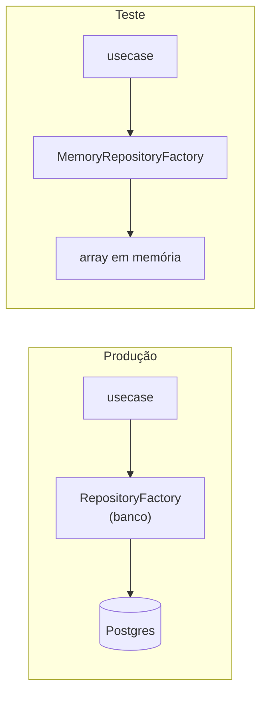

# 09 — Testes

## O que as fontes dizem sobre testes

Não existe um doc dedicado a testes. A estratégia aparece em frases soltas:

| Onde | Trecho |
|---|---|
| `ddd-architecture.md` | "**Foco em testes:** incentiva **testes de memória** pela alta cobertura e baixo esforço" |
| `infra-layer-repository-folder.md` | "Facilitar testes unitários (você pode mockar o repositório ou adapter para **testes de memória**)" |
| `domain-layer-value-object-folder.md` | "Fácil de testar isoladamente. Comportamento previsível. Reduz a complexidade dos testes" |
| `application-layer-usecase-folder.md` | "Facilita testes unitários: fácil mockar dependências e testar comportamento" |
| `application-layer-handle-folder.md` | "Permite testes isolados (você pode simular mensagens)" |
| `presentation-layer.md` | "Facilidade de testes com simulações de entrada e verificação de chamadas" |
| `application-layer-factory-folder.md` | "Facilita testes, mock e inversão de dependência. Permite alternar implementações (ex.: **usar memória ou banco real**)" |
| `building-blocks-layer.md` | "Fácil de mockar contratos como HttpClient, Publisher, etc." |

## A ideia central: teste de memória

O mesmo usecase roda nos dois mundos, porque depende só do **contrato** em `data`. No teste, o repositório é um array. Sem banco, sem rede, sem mock complicado: rápido e com alta cobertura.

## O que testar em cada peça (Sugestão, coerente com as fontes)

| Peça | Entra por | Garante |
|---|---|---|
| **Value Object** | `new` e métodos públicos | Formato inválido lança erro; normalização; comparações |
| **Entity** | `new` e métodos públicos | Invariante própria (ex.: `start <= end`); comportamento |
| **Aggregate Root** | `addRange`, `covers`... | Invariantes **entre** entities (ex.: sem sobreposição) |
| **Domain Service** | método público | Resultado do cálculo com entradas conhecidas |
| **Mapper / Factory** | função / método estático | Entrada crua vira entity válida; entrada inválida propaga erro |
| **Usecase** | `execute` com repositório em memória | Fluxo: unicidade, regras, persistência |
| **Controller** | `execute` com factories em memória | Validação de input, permissão, formato da resposta |
| **Handler** | `handle(message, ack, nack)` com `ack`/`nack` falsos | Mensagem inválida dá `nack`; válida chama usecase e dá `ack` |
| **Repository / Mutation / Query reais** | contra banco de teste | Mapeamento e transação (menos testes, mais lentos) |

## Dois erros comuns

1. **Testar estado interno** (`#data`, campos privados). O teste quebra em qualquer refatoração. Teste o comportamento observável.
2. **Testar a regra no nível errado.** Se "sem sobreposição" está no aggregate, o teste vai no aggregate, não na entity.

## "Sempre o nível acima, o handle"

> **PENDENTE.** Este trecho veio de uma conversa verbal do Jefferson e **não está nas fontes**. Duas leituras plausíveis:
>
> 1. **Teste pela porta pública do nível de cima.** Em vez de espiar o interior, você exercita o contrato que o nível acima consome. Para o domain, o "nível acima" é a application, que chama `new`, `addRange`, `covers`. Para a application, o "handle" é o ponto de entrada do caso de uso (`execute` ou `handle`).
> 2. **Cada nível é testado pelo seu `handle`.** O `handle` do Handler/Usecase é o método que recebe a entrada e orquestra o resto.
>
> Preencha esta seção com a explicação exata depois de confirmar com o Jefferson.
