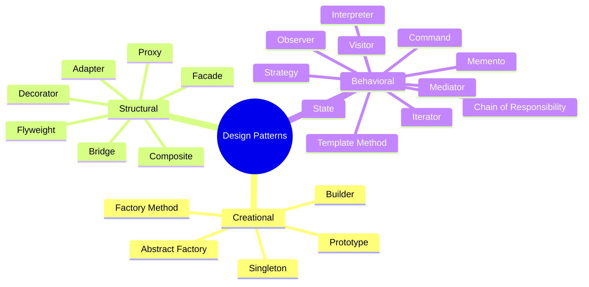
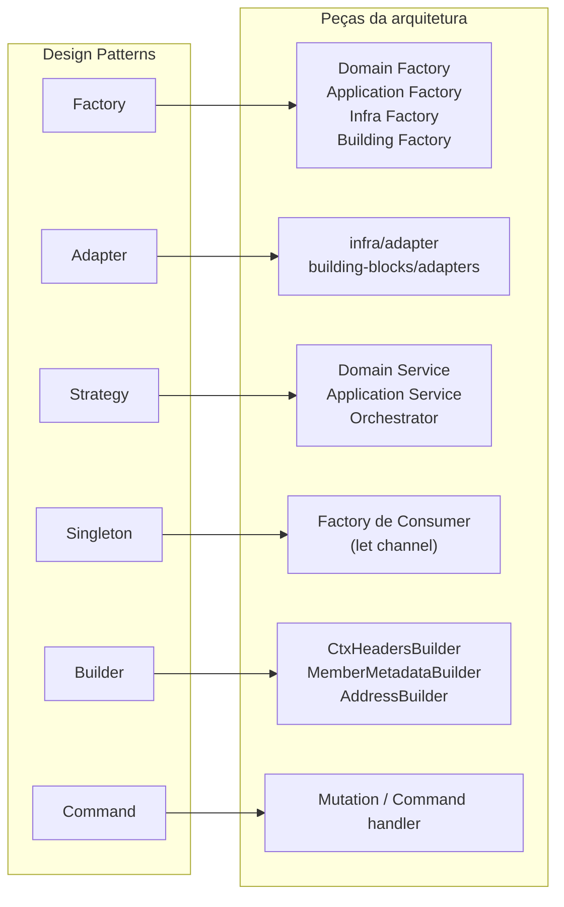

# 10 — Design Patterns

**Fontes:** [`sources/design-patterns/docs/`](../sources/design-patterns/docs) (um doc por padrão) e [`sources/design-patterns/behavioral/`](../sources/design-patterns/behavioral) (código).

> "Design Patterns é uma descrição ou modelo (template) de como resolver um problema que pode ser usado em muitas situações diferentes." — `README.md` do repo.

## Os 23 padrões do GoF em um mapa

O "Gang of Four" (Gamma, Helm, Johnson, Vlissides, 1995) catalogou 23 padrões em 3 famílias. Os docs das fontes cobrem os 23.

| Família | Pergunta que responde (Fonte: `design-patterns-creational.md` e `design-patterns-structural.md`) |
|---|---|
| **Creational** | "Como instanciar um Pedido?" Criação flexível, controlada, centralizada |
| **Structural** | "Como organizar um Pedido com outros objetos?" Composição de objetos e classes |
| **Behavioral** | "Como o Pedido muda de estado?" Comunicação e interação entre objetos |

## Catálogo: o que cada padrão resolve

A coluna "Quando usar" resume a seção **Aplicabilidade** de cada doc.

### Creational

| Padrão | Quando usar | Doc | Código |
|---|---|---|---|
| **Factory Method** e **Abstract Factory** | Criação complexa ou que pode mudar; várias famílias de objetos relacionados | [`creational-factory`](../sources/design-patterns/docs/design-patterns-creational-factory.md) | no próprio doc |
| **Builder** | O algoritmo de criação deve ser independente das partes; suportar várias representações | [`creational-builder`](../sources/design-patterns/docs/design-patterns-creational-builder.md) | no doc (documentos A4/A3) |
| **Prototype** | Classes especificadas em runtime; poucas combinações de estado; evitar hierarquia paralela de fábricas | [`creational-prototype`](../sources/design-patterns/docs/design-patterns-creational-prototype.md) | no doc (clonagem rasa x profunda) |
| **Singleton** | Uma única instância, acessível globalmente, com acesso controlado | [`creational-singleton`](../sources/design-patterns/docs/design-patterns-creational-singleton.md) | no doc |

### Structural

| Padrão | Quando usar | Doc |
|---|---|---|
| **Adapter** | Converter uma interface em outra; herança (adapter de classe) ou composição (adapter de objeto); inbound e outbound | [`structural-adapters`](../sources/design-patterns/docs/design-patterns-structural-adapters.md) |
| **Bridge** | Evitar ligação permanente entre abstração e implementação; reduzir proliferação de classes | [`structural-bridge`](../sources/design-patterns/docs/design-patterns-structural-bridge.md) |
| **Composite** | Hierarquias parte-todo; tratar objeto individual e composição de forma uniforme (exemplo: pastas) | [`structural-composite`](../sources/design-patterns/docs/design-patterns-structural-composite.md) |
| **Decorator** | Adicionar comportamento dinamicamente; evitar explosão de subclasses | ver errata: o conteúdo está no arquivo `structural-facade.md` |
| **Facade** | Interface simplificada para um subsistema | ver errata: o conteúdo está no arquivo `structural-decorator.md` |
| **Flyweight** | Muitos objetos; separar estado intrínseco do extrínseco (exemplo: árvores e espécies) | [`structural-flyweight`](../sources/design-patterns/docs/design-patterns-structural-flyweight.md) |
| **Proxy** | Remoto, virtual (sob demanda), de proteção (acesso), referências inteligentes | [`structural-proxy`](../sources/design-patterns/docs/design-patterns-structural-proxy.md) |

### Behavioral

| Padrão | Quando usar | Doc | Código no repo |
|---|---|---|---|
| **Chain of Responsibility** | Vários objetos podem tratar a solicitação; cadeia definida dinamicamente | [doc](../sources/design-patterns/docs/design-patterns-behavioral-chain-of-responsibility.md) | |
| **Command** | Parametrizar ações, enfileirar, desfazer, registrar mudanças | [doc](../sources/design-patterns/docs/design-patterns-behavioral-command.md) | [`behavioral/command`](../sources/design-patterns/behavioral/command) (Account: crédito/débito) |
| **Interpreter** | Linguagem simples representável como árvore sintática | [doc](../sources/design-patterns/docs/design-patterns-behavioral-interpreter.md) | |
| **Iterator** | Acessar um agregado sem expor sua estrutura; tipos de iteração | [doc](../sources/design-patterns/docs/design-patterns-behavioral-iterator.md) | |
| **Mediator** | Centralizar a comunicação entre objetos, reduzindo acoplamento | [doc](../sources/design-patterns/docs/design-patterns-behavioral-mediator.md) | [`behavioral/mediator`](../sources/design-patterns/behavioral/mediator) (ChatRoom) |
| **Memento** | Salvar e restaurar estado sem violar encapsulamento | [doc](../sources/design-patterns/docs/design-patterns-behavioral-memento.md) | |
| **Observer** | Mudança em um objeto atualiza outros sem acoplamento forte (1 para muitos) | [doc](../sources/design-patterns/docs/design-patterns-behavioral-observer.md) | [`behavioral/observer`](../sources/design-patterns/behavioral/observer) (InputText e Label) |
| **State** | Comportamento depende do estado; elimina condicionais complexas | [doc](../sources/design-patterns/docs/design-patterns-behavioral-state.md) | [`behavioral/state`](../sources/design-patterns/behavioral/state) (Order: open, confirmed, cancelled) |
| **Strategy** | Variantes de algoritmo; remover condicionais | [doc](../sources/design-patterns/docs/design-patterns-behavioral-strategy.md) | [`behavioral/strategy`](../sources/design-patterns/behavioral/strategy) (ParkingLot) |
| **Template Method** | Algoritmo com partes fixas e variáveis; evitar duplicação | [doc](../sources/design-patterns/docs/design-patterns-behavioral-template-method.md) | [`behavioral/template_method`](../sources/design-patterns/behavioral/template_method) (impostos) |
| **Visitor** | Nova operação sobre uma estrutura de objetos sem alterá-los | [doc](../sources/design-patterns/docs/design-patterns-behavioral-visitor.md) | |

## Como diferenciar padrões parecidos

As fontes fazem estas distinções no `behavioral/mediator/README.md`:

| Padrão | Ideia | Relação |
|---|---|---|
| **Command** | Abstrai uma solicitação em um objeto para executar depois (desfazer, refazer, deslogar) | 1 solicitação reificada |
| **Observer** | Um objeto notifica vários (várias `Label` observando um `InputText`) | **1 para muitos** |
| **Mediator** | Objeto central que reduz o acoplamento entre vários | **muitos através de um** |

> "Esses dois padrões estão na base do que entendemos como arquitetura voltada a eventos. Sabe qual por exemplo? **CQRS!**" — ver [11](11-cqrs-e-event-sourcing.md).

A tabela abaixo é **conhecimento geral do GoF** (Sugestão), não está nas fontes:

| Parecem iguais | Diferença |
|---|---|
| **Strategy** x **State** | Strategy: o cliente escolhe o algoritmo. State: o próprio objeto troca de estado e de comportamento |
| **Strategy** x **Template Method** | Strategy troca o algoritmo inteiro por composição. Template Method fixa o esqueleto e varia passos por herança |
| **Factory** x **Builder** | Factory decide **qual** objeto criar. Builder monta **passo a passo** um objeto complexo |
| **Adapter** x **Facade** | Adapter converte **uma** interface em outra. Facade simplifica **um subsistema** |

## Onde os padrões aparecem na arquitetura

Os docs de arquitetura citam padrões em vários pontos. Mapa **derivado**:

| Padrão | Onde as fontes usam | Citação |
|---|---|---|
| **Factory Method** | Domain Factory, para "famílias customizadas" do negócio | `ddd-architecture-factory-folder.md` |
| **Abstract Factory** | Application / Infra / Building Factory, para famílias **arquiteturais** | idem |
| **Adapter** | `infra/adapter`, `building-blocks/adapters` | `infra-layer-adapter-folder.md` |
| **Strategy** | `FreightCalculationService` com `DistanceCalculationStrategy` | `domain-layer-service-folder.md` |
| **Strategy** (sugerido) | Orchestrator "é bem-vindo ser usado em conjunto com alguma estratégia de Design Pattern" | `application-layer-orchestrator-folder.md` |
| **Behavioral** (genérico) | Application Service "muitas das vezes seguindo algum Behavior Design Pattern" | `application-layer-service-folder.md` |
| **Singleton** | Factory de Consumer guarda a instância em `let channel` | `building-blocks-layer-factory-folder.md` |
| **Service Locator** | Mesma factory: "atua como Service Locator para instanciar o driver correto" | idem |
| **Builder** | `CtxHeadersBuilder`, `MemberMetadataBuilder`, `AddressBuilder` aparecem nos exemplos | `usecase-folder.md`, `value-object-folder.md` |
| **Command / CQRS** | Mutation e Query | `infra-layer-mutation-folder.md` |
| **Repository** | Não é do GoF, mas é o padrão de persistência da arquitetura | `infra-layer-repository-folder.md` |

## Factory em detalhe

**Fonte:** `design-patterns-creational-factory.md`

| Variante | O que é | Uso típico |
|---|---|---|
| **Factory Method** | Métodos que criam instâncias conforme uma condição (ex.: frete expresso ou econômico, erro para tipo desconhecido) | "Famílias" do negócio, como Freight |
| **Abstract Factory** | Interface para criar **famílias de objetos relacionados e compatíveis** (ex.: factory de usecases recebendo uma factory de repositórios) | Famílias arquiteturais |
| **Static Factory** | Métodos estáticos com nomes descritivos no lugar de vários construtores | `CarrierCoverageFactory.fromRaw(rows)` (do exemplo deste projeto) |
| **Builder Factory** | Construção passo a passo, pode gerar objetos imutáveis | Muitos parâmetros |
| **Simple Factory** | Criação direta e centralizada | Casos básicos |

Benefícios: simplifica a criação, reduz acoplamento, melhora testes, apoia SOLID (inversão de dependência e aberto/fechado).

## Referências citadas pelas fontes

- Refactoring Guru: <https://refactoring.guru/design-patterns>
- SourceMaking: <https://sourcemaking.com/design_patterns>
- GeeksforGeeks: <https://www.geeksforgeeks.org/software-design-patterns/>
- TutorialsPoint: <https://www.tutorialspoint.com/design_pattern/index.htm>
- Wikipedia: <https://en.wikipedia.org/wiki/Design_Patterns>
- Repositórios de referência: `gabrmsouza/design-patterns`, `rodrigobranas/design_patterns`
