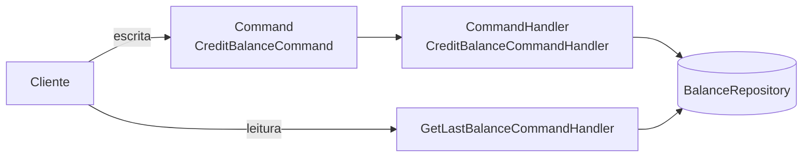
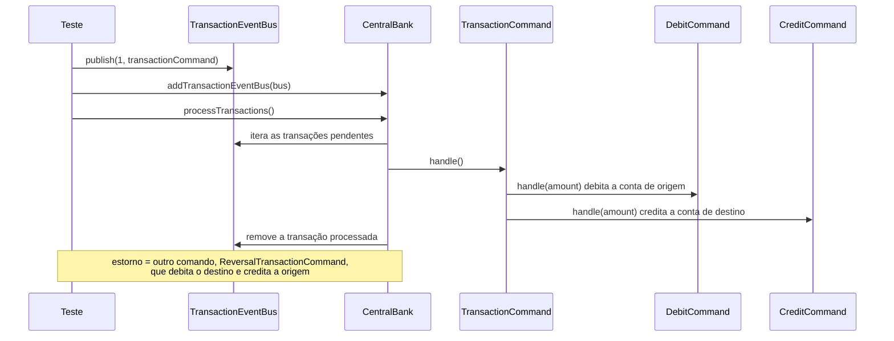

# 11 — CQRS e Event Sourcing

**Fontes:** [`sources/design-architecture/cqrs`](../sources/design-architecture/cqrs) (README + código), [`sources/design-architecture/event-sourcing`](../sources/design-architecture/event-sourcing) (código). O Event Sourcing **não tem README**: o que está aqui sobre ele é leitura do código.

## CQRS

**Command Query Responsibility Segregation**, criado por Greg Young. Baseado no CQS (Command Query Separation) de Bertrand Meyer.

> "Ao executar um *Command* que modifica os dados, não deve retornar um resultado, enquanto manusear uma *Query* que retorna um dado, não deve modificar. Ou apenas altera, ou apenas retorna." — `cqrs/README.md`



### Exemplo da fonte: saldo de conta

| Operação | Tipo | Classe |
|---|---|---|
| Ver o saldo | Consulta (Query) | `GetLastBalanceCommandHandler` |
| Creditar / debitar | Gravação (Command) | `CreditBalanceCommandHandler` |

```ts
// CommandHandler<T> é genérico no retorno
export default interface CommandHandler<T> {
  handle(command: Command): T
}

export default class CreditBalanceCommandHandler implements CommandHandler<void> {
  constructor(private balanceRepository: BalanceRepository) {}
  handle(command: CreditBalanceCommand): void {
    this.balanceRepository.credit(command)
  }
}
```

Repare que o **command devolve `void`** e a **query devolve `Balance`**. É o CQS em ação.

### Quando aplicar

Segundo o README: "mais indicado para domínios complexos, ou que podem se tornar complexos a curto prazo". Em domínios simples "acrescenta complexidade aumentando os riscos". "O mais importante é entender a ideia de separação."

Implementação: manual, ou com **Event Sourcing** ou **Command Handler**.

### Onde isso aparece na arquitetura

A camada `infra` traduz CQRS em duas pastas ([04](04-infra.md)):

| CQRS | Pasta |
|---|---|
| Command (escrita) | `infra/mutations`, com um único método `execute` |
| Query (leitura) | `infra/queries`, com um único método `execute` |

## Event Sourcing (leitura do código)

O exemplo simula um **PIX** com um barramento de eventos e um banco central.



| Classe | Papel |
|---|---|
| `Account` | Conta com `balance`, `debit`, `credit` |
| `DebitCommand` / `CreditCommand` | Comandos atômicos sobre uma conta |
| `TransactionCommand` | Compõe um débito e um crédito (uma transferência) |
| `ReversalTransactionCommand` | Mesma forma, usada para estornar |
| `TransactionEventBus` | Guarda transações por id (`Map`) |
| `CentralBank` | Consome o barramento e processa, removendo as concluídas |

O teste "fazer um PIX e logo após estornar" mostra a ideia central: **o estorno não apaga nada, é um novo evento** que compensa o anterior.

> **Nota:** é uma versão simplificada. Event Sourcing "de verdade" guarda o log de eventos como fonte de verdade e reconstrói o estado reaplicando-os. Aqui o bus guarda comandos pendentes e os remove ao processar. Use o exemplo para entender comandos + barramento, e consulte as referências do README para o padrão completo.

## Referências do README

- <http://martinfowler.com/bliki/CQRS.html>
- <https://lostechies.com/gabrielschenker/2015/04/07/cqrs-revisited/>
- <http://elemarjr.com/pt/2016/04/11/uma-breve-revisao-de-cqrs/>
