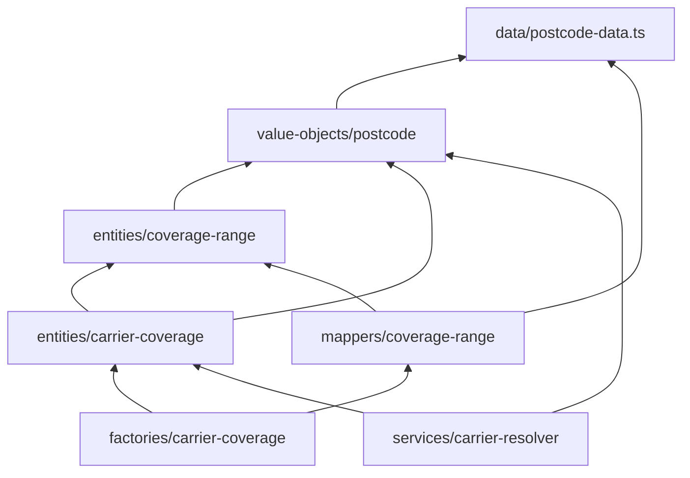

# Exemplo: cobertura de CEP por transportadora

Exemplo executável das camadas **data** e **domain**, baseado no exercício `carrier-coverage` do `domain-model`. Segue as regras dos guias [03](../../docs/03-data-e-domain.md), [08](../../docs/08-dependencias-e-nomenclatura.md) e [09](../../docs/09-testes.md).

## Rodar

Requer [Bun](https://bun.sh).

```bash
bun install
bun test
bun run typecheck
```

> **Status:** este código foi escrito sem acesso a um runtime (Bun/Node) no ambiente de criação. Os testes foram conferidos **à mão**, mas **ainda não foram executados**. Rode `bun test` antes de confiar neles e corrija qualquer divergência.

## Regras de negócio

- `Postcode` aceita `12345678` ou `12345-678`. Todo o resto lança erro.
- `CoverageRange` exige `start <= end`.
- `CarrierCoverage` exige ao menos 1 faixa e **rejeita sobreposição** (faixas que se tocam também se sobrepõem).
- `covers(postcode)` é `true` se o CEP está **dentro** de alguma faixa, bordas incluídas.

## Mapa de arquivos

```text
src/modules/carrier-coverage/
├── data/
│   └── postcode-data.ts                  ← schema, regex e tipo (camada DATA)
└── domain/
    ├── value-objects/
    │   └── postcode-value-object.ts      ← VALUE OBJECT: imutável, auto-validado
    ├── entities/
    │   ├── coverage-range-entity.ts      ← ENTITY: id derivado, start <= end
    │   └── carrier-coverage-entity.ts    ← AGGREGATE ROOT: sem sobreposição
    ├── mappers/
    │   └── coverage-range-mapper.ts      ← MAPPER: linha crua <-> entity
    ├── factories/
    │   └── carrier-coverage-factory.ts   ← DOMAIN FACTORY: monta o aggregate
    └── services/
        └── carrier-resolver-service.ts   ← DOMAIN SERVICE: quais transportadoras atendem
```

Cada arquivo tem o seu `*.test.ts` ao lado.

## Quem importa quem



Nada aqui importa de `infra`, `application`, banco ou HTTP. Por isso os testes não usam mock.

## Exercício: responda antes de olhar o código

1. **Qual arquivo é Data e por quê?**
   `postcode-data.ts`. Só descreve formato (regex, schema, tipos). Não tem comportamento.
2. **Por que `overlaps` fica na `CoverageRange`, mas a rejeição fica no `CarrierCoverage`?**
   Uma faixa sabe se comparar com **outra faixa** (`overlaps`), mas só o aggregate enxerga **todas** as faixas e pode decidir o que fazer. A invariante "sem sobreposição" é do conjunto.
3. **O que acontece com `new Postcode('1234')`?**
   O schema falha e o constructor lança erro. O objeto nunca é criado.
4. **Por que `ranges` devolve uma cópia?**
   Para ninguém de fora fazer `.push()` e burlar a regra. Todo acesso passa pelo root (`addRange`).
5. **Por que `Postcode` compara strings e não números?**
   O valor sempre tem 8 dígitos, então a ordem lexicográfica é igual à numérica. Converter para número perderia o zero à esquerda se fosse impresso de novo.
6. **Por que `CarrierResolverService` é um Domain Service e não um método do aggregate?**
   Ele envolve **vários** aggregates (um por transportadora), então não pertence a nenhum deles. Também não persiste nada, e quem carrega as coberturas é a infra.

## Diferenças em relação ao exercício original

| Original (`respect/`) | Aqui | Motivo |
|---|---|---|
| `covers` compara só `start` e `end` | `covers` usa `contains` (intervalo) | Critério de aceite: CEP "dentro" de uma faixa |
| `addRange` checa só `id` repetido | `addRange` usa `overlaps` | Critério de aceite: rejeitar sobreposição |
| `new Error()` sem mensagem | Mensagens explícitas | O teste distingue qual regra falhou |
| `CarrierCoverage` sem construtor | Exige ao menos 1 faixa | Pedido no README do exercício |
| Schema `.min(8).max(9)` + `replace(/\D/g, '')` | `regex(/^\d{5}-?\d{3}$/)` | O original aceitava `123456789` (9 dígitos) e `12345678a` (letra no fim) |
| Arquivos soltos na mesma pasta | `data/` e `domain/` com subpastas | Estrutura dos guias [02](../../docs/02-estrutura-de-pastas.md) |
